# Iris API design and migration contract

Status: implemented draft for generation, geometry, placement, resources and typed storage;
reference registry/planners/examples verified without the Iris engine. Provider and runtime
families below describe the intended design, not Java interfaces already available.

The project decision is to establish a usable public interface first, then migrate built-in
features, then refine composition. A stable published API should follow representative real
ports and compatibility checks. Existing built-ins have now been extracted into the
[default module](../IrisModule/README.md), preserving their legacy engine dependencies.
That source extraction does not yet make them public-API implementations.

## Target shape

An Iris module owns annotated configuration and configured behavior. The host owns resource
loading, platform adapters, scheduling, storage, lifecycle, and publication. Built-ins and
external addons should eventually use the same feature registration interface.

```mermaid
flowchart TD
    Modules[Built-in and addon modules] --> Registry[Feature registration]
    Registry --> Catalog[Frozen catalog and metadata]
    Catalog --> Decode[Host JSON decoding and validation]
    Decode --> Factories[Configured factories]
    Factories --> Generation[Chunk modifiers]
    Factories --> Geometry[Sparse object generators]
    Factories --> Placement[Placement modifiers]
    Geometry --> Objects[Immutable generated objects]
    Objects --> Placement
    Generation --> Hunk[Local dense output]
    Placement --> Edit[Buffered world-space placement]
    Resources[Pack snapshot and platform adapters] --> Generation
    Resources --> Geometry
    Resources --> Placement
    Hunk --> Publish[Host publication]
    Edit --> Publish
```



The three execution interfaces are deliberately distinct:

- Chunk modifiers work on dense local volumes.
- Geometry generators return reusable sparse objects without world writes.
- Placement modifiers inspect and change one attempt with ordered hooks and buffered writes.

A vacuum operation is a placement modifier, not a chunk modifier. A crystal generator produces
geometry, not a dense chunk. Surface decoration generally writes dense blocks but may share
palette and support adapters with object placement. Existing engine helper classes are
implementation details, not types to copy into the public interface.

## Registration and configuration

`IrisModule.register(FeatureRegistry)` registers typed settings-to-behavior factories. Settings
implement `IrisFeature`; `@Feature` declares namespaced identity, display name, JSON field and
attachment targets. The module constructor/factory must not need predecessors to have run.

The current registration interface has four operations:

```java
registry.register(featureType, outputType, modifierFactory);
registry.registerObject(featureType, geometryFactory);
registry.registerPlacement(featureType, placementFactory);
registry.registerMantle(layerKey, lifetime, codec);
```

Feature IDs are unique across all kinds. A class can have one registration kind. A JSON field is
unique per attachment target, including existing host fields. The reference registry takes
reserved host fields explicitly; it cannot discover them from an engine it does not depend on.
Placement modifiers attach only to object-placement settings. Geometry may be declared at
biome/region/dimension scope, with host composition deciding which placement uses it.

`ModuleRegistry` validates a registration before changing its catalog. At the end of collection,
`freeze()` prevents further mutation and exposes deterministic catalog lists. Module discovery
itself remains host-owned. The host must reject duplicate module identities and incompatible
API versions before publishing a pack runtime, and discard a registry build when a module
callback fails. Addon classloading must not expose engine implementation packages as public types.

Host decoding preserves existing JSON field names and constructor/field defaults. It must invoke
constructors, reject invalid values with resource/field diagnostics and validate required fields,
numeric constraints, nested settings, lists, enums and typed resource references. Schema generation
uses the same metadata and resource registries. Existing registry-list annotations require
explicit metadata adapters during migration; the draft does not reproduce every old annotation.

`OptionsMetadata` currently describes reflected fields and checks annotation bounds. It is not a
decoder or complete schema implementation. No JSON library has been added to the public project.

## Identity, order and applicability

There are four different identities:

| Identity | Purpose |
| --- | --- |
| Module identity | Discovery, diagnostics and compatibility |
| Feature identity | Configuration registration and schema |
| Modifier identity | Dependency graph vertex shared by its configured occurrences |
| Occurrence identity | A specific configuration in one pack snapshot |

Modifier IDs are stable and namespaced. Repeated configured instances must use the same
implementation and dependency declaration; generation instances must also agree on output type.
Their settings and reach may differ. Host occurrence IDs must be stable for the same pack input,
for example an owner ID plus the configuration path/index.

`Dependencies` declares required predecessors and optional before/after edges. `GenerationPlan`
resolves the complete chunk graph across output types; `PlacementPipeline` resolves a separate
placement graph. Required dependencies never install or activate a feature. Self-dependencies,
missing required vertices, cycles and conflicting identities fail before generation. Ready
vertices and repeated occurrences use lexical order, independent of module discovery.

Applicability is host-owned. Resolving a required modifier ID does not promise that its configured
feature writes at every position. An executor dispatches only the occurrences applicable to the
current invocation, respecting the resolved ordering. Per-position reads come through
`FeatureSettings.at(type, target, worldPosition)`; target declarations stay separate and results
follow pack declaration order after target-local inheritance rules. The host must define legacy
list combination and override policies explicitly, not assume one universal precedence.

The host bridges current engine lifecycle barriers into the graph. For the current overworld,
that includes biome/Mantle/terrain preparation followed by carving, post-processing, floating
terrain, deposits, Mantle insertion, decoration, floating decoration, perfection and custom-block
recording. Moving ore work out of terrain must preserve its original replacement/random behavior.
A graph that violates engine barriers is a pack-load error, even if it is topologically acyclic.

## Invocation inputs and concurrency

Factories snapshot settings. No invocation views, scratch data or mutable RNG state belong on a
configured feature implementation. Different hunks/placements may invoke it concurrently.

`InvocationContext` exposes world seed, one pack snapshot and a dedicated RNG. The host derives
streams from stable identities and invocation/variant position, not discovery or scheduler order.
An Iris compatibility adapter must preserve legacy seed offsets, random consumption and iteration
order where existing world output is promised; merely choosing a new deterministic RNG is not
compatibility. Objects may cache immutable variants, never the RNG or invocation context.

`GenerationContext` adds world-block origin, terrain/settings views and invocation-scoped Mantle.
Hunk coordinates are local; samples and storage coordinates are world blocks. A dense block cell
corresponds to one world block. Native biome grids or coarser density grids require an explicit
adapter; do not reinterpret a Hunk index as a different unit silently.

`TerrainSampler` is the prepared terrain field, including surface height, fluid height, slope and
pack biome identity. `BlockView` is prepared generation blocks, not live-world access. Placement
context block reads refer to the pre-placement state; hook access reads buffered changes.
All prepared views have explicit bounds/lifetimes. Unsupported access fails rather than clipping.

## Resource and platform adapters

`ResourceId` parses explicit namespaced identities; `ResourceKey<T>` states the public value type.
`PackResources` resolves resources within one immutable loaded snapshot. A known ID requested
with the wrong type is an error. Missing and malformed resources are different states. Imports
and caches are snapshot-scoped; every reload produces a different snapshot ID.

`BlockState` is an immutable description with value equality and sorted canonical properties.
Construction validates syntax. `BlockRegistry` resolves availability/valid properties and cached
traits, tags and attachment checks. No native handle escapes. Custom block identities remain
expressible; the host handles their generation placeholders and deferred application.
`BlockPalette` and `NoiseSampler` are resource types, not engine services reconstructed by addons.

Block entity payloads have a format ID, version and defensive byte copies. Adapters interpret
them, enforce size/compatibility limits and reject unsupported versions. Markers carry an ID and
immutable attributes; registry owners define their meaning. Mutable NBT/Bukkit objects must not
appear in reusable geometry or public feature settings.

## Geometry and transforms

`GeneratedObject` contains local bounds, a local anchor, sorted sparse blocks, optional block
entity payloads and markers. Entries must lie inside bounds; duplicate block positions fail.
An anchor can lie outside geometry. Missing entries do not mean explicit air. Declaration order
is preserved for markers sharing a position. Geometry has no world coordinates or placement state.

A configured `ObjectGenerator` receives only resources and a geometry invocation RNG and returns
immutable geometry. Terrain-aware adaptation happens in placement. The host controls variant
selection and cache keys, which must include the pack snapshot and relevant settings/seed.

`ObjectTransformer` is host-owned. It updates geometry bounds/anchor, block orientation, markers
and block entities for an `ObjectTransform`. The transform specifies mirrors, positive per-axis
scale and rotations around the anchor; rasterization/interpolation is adapter-owned. Unsupported
transformations fail explicitly. Noise-based object warping/shaping needs a later typed transform
extension when the placement port demonstrates its requirements.

## Placement lifecycle and ownership

`PlacementRequest` aligns local anchor to world anchor with checked arithmetic. Geometry has
already been transformed; a prepare hook may replace it via the host transformer. It must keep
the same attempt ID. The host supplies enough prepared space for supported changes; unsupported
moves fail rather than silently cropping the object.

The reference pipeline executes these barriers:

| Barrier | What modules can do |
| --- | --- |
| Prepare | Return a new request or reject the attempt |
| Map blocks | Replace/skip individual proposed world-space blocks |
| Validate | Inspect the complete proposed plan and pre-placement views; no mutation |
| Before placement | Buffer boring or preparation after all validation succeeds |
| Object writes | Host buffers mapped blocks, block entities and markers |
| After placement | Buffer foundation/vacuum/snow/metadata work using overlay and accepted writes |
| Commit | Host publishes the entire edit once |

`PlacementPlan.writtenBounds()` measures accepted object writes, not original geometry or later
finishing writes. An empty block plan has no written bounds. Markers are included in the attempt
but tracked separately. Skipped blocks cannot contribute falsely to a vacuum footprint.

Hook `PlacementAccess` has no commit/close methods. The reference runner supplies a restricted
view covering the final object's footprint plus declared horizontal reach and authorized vertical
bounds, including a similarly restricted Mantle view. Nested Mantle edits are forbidden because
placement already owns the transaction. Retaining any view past completion is invalid.

Host intrinsic validation covers collision/protection/support/material/payload policies. Every
buffered hook write must also satisfy host bounds and platform validation. Exceptions and
rejections close without commit. Commit is atomic across block/entity/marker/Mantle changes in
generation storage. This stronger guarantee still needs an Iris storage adapter; it is not
inherited automatically from existing placement behavior and does not imply disk/live-world
atomicity. The host aborts chunk publication when any generation work fails.

## Typed storage and neighbor scheduling

The Mantle interface retains namespaced typed keys, codecs, generation/persistent lifetime,
ordered sparse visits, world bounds and buffered edits. Only owners register layer keys. Known
type mismatches and duplicate IDs fail. Generation-only values still need codecs for unloading.
Missing reads allocate nothing. Unknown persisted layers are preserved or cause explicit failure.

Chunk modifiers declare `mantleRadius`; placement modifiers declare `writeRadius`. The host
prepares bounds, relevant predecessor work and neighbors before execution and serializes
intersecting write areas. No dependency edge does not imply safe concurrent writes. Cleanup
waits for every consumer, including neighboring generation. Native chunk/section storage and
retention flags remain implementation details.

## Complete feature-family migration map

Each row names the existing feature family and where it fits. This is a migration inventory,
not a claim that those features are ported or that every interface below already exists.

| Existing family | Target interface/composition | Readiness |
| --- | --- | --- |
| Surface, ceiling, shore, sea-surface, sea-floor and floating decoration | Chunk modifiers + palette/support/sampling adapters | Core contracts exist; real decorators still engine-dependent |
| Slab/wall/snow post-processing; unsupported foliage cleanup; ore hiding | Chunk modifiers + block traits/properties + neighbor views | Contracts exist; finish ports pending |
| Custom block recording and deferred application | Chunk modifier + persistent typed layers + host content adapter | Layer/block contracts exist; deferred adapter pending |
| Surface/underground ores and deposits/variants/shapes/scopes | Chunk modifiers + noise/palette resources + effective settings | Core contracts exist; precedence and parity port pending |
| Object selection, chance/density, transforms and all height/placement modes | Geometry resources + placement composition | Core contracts exist; real placement modes pending |
| Stilt, eroded/organic support, ceiling hang, vacuum variants, paint/floating | Placement prepare/map/validate/before/after hooks | Reference foundation proves hooks; original algorithms pending |
| Slope/support/limits/collision/protection, boring/melding/replacement/water/snow | Placement policies and hooks + prepared block view | Contracts exist; policy/algorithm ports pending |
| Object markers, tile data, tree/loot metadata | Object metadata + placement transaction + typed storage | Value contracts exist; codecs/consumers pending |
| Procedural trees, crystals, fungi, coral, formations and ruins | Object generators returning sparse geometry | Reference column proves composition; six real generators pending |
| Cave density profiles/modules, entries, biome blending and surface openings | Chunk planning/application + noise/sampling + typed carve layers | Core contracts exist; typed carve payloads and real ports pending |
| Cave fluids/lava, floor/ceiling palettes, decorations and cave objects | Ordered carve/placement composition + fluid/support layers | Core contracts exist; payloads and coordination pending |
| Floating child biomes/islands, palettes, merging/overrides and inverted objects | Terrain/biome sampling + chunk/placement composition | Core contracts exist; provider/algorithm ports pending |
| Structure distribution/anchors/Y bands, carving, foundations/stilts and pieces | Structure assembly produces placement plans; host schedules writes | Geometry/placement exist; assembly interface pending |
| Jigsaw pools/connectors/rules/themes/workcells/branch policies | Typed structure resources + host-independent assembly interface | Public assembly/resource models pending |
| Imported/native structures/features, frequency and ownership/protection | Host native-generation policy adapter + typed ownership records | Policy interface/adapter pending |
| Terrain generators/layers/palettes/fluids/bedrock, interpolation/overlays | Terrain providers + ordered chunk modifiers | Consumption interfaces exist; provider registration pending |
| Region/biome selection, rarity/children/scatter/custom derivatives | Biome providers + platform biome writer | Sampling exists; provider/writer interfaces pending |
| Overworld/islands/enclosure/superflat modes and upper dimensions | Host composition of registered terrain/biome/generation providers | Composition interface/adapter pending |
| Image height/color maps, masks/transforms/bindings | Immutable sampled resources composed into providers | Generic resource seam exists; image resource models pending |
| Noise styles/expressions and pack mod injection/replacement | Immutable noise resources + pack compilation transformations | Sampling exists; loader/transform interface pending |
| Entity/marker spawning, ambient effects, block drops and loot | Runtime registrations + scoped host actions/events | Separate runtime interface pending |
| Marker commands, tree growth/replacement/felling, time/weather | Runtime registrations + platform-specific action adapters | Separate runtime interface pending |
| World/pregen lifecycle, queries, locating and studio/editor tooling | Bridge existing integrations; consume public resources/providers | Integration/tooling adapters pending |

## Provider and runtime direction

These are design decisions for the next ports, not speculative stub Java methods:

- Terrain and biome providers should return sampled fields/resolved identities. The host compiles
  composition and adapts outputs to native chunk/biome formats. They must not own worlds or ticks.
- Structure assembly should consume immutable typed resources and return immutable placement
  intents/results. The host owns reach preparation, scheduling, native-generation gates and edits.
- Image maps and expressions should be compiled pack resources reused by providers/features.
  Pack transformations run during compilation, before a runtime snapshot is published.
- Runtime features need their own registration/execution family: read-only event/context inputs
  and requested effects/actions, performed by host adapters on the correct platform scheduler.
  Generation hunks/RNG/views must never be reused for entity spawning or live-world edits.
- Existing terrain-query, world lifecycle, pregeneration and tree integration interfaces should
  be bridged and consolidated where useful, not duplicated just to fit the new package layout.

Exact method signatures for these families should be settled against their first real port.
The draft establishes how they compose without prematurely copying the full Engine interface.

## Implementation and validation gates

Implemented: public contracts listed above, registry/catalog validation, dependency planner,
bounded reference Hunk, placement orchestration/restricted views and three example behaviors.
Not implemented: discovery/version gating, JSON/schema loaders, resource/platform/storage adapters,
neighbor scheduler, Iris lifecycle bridging, provider/runtime registrations or real Iris feature ports.

The API tests exercise registry conflicts, ordering/cycles, immutability, checked coordinates,
placement validation/rejection, commit failure, hook reach/lifetime and all-or-nothing orchestration
against a test edit. The example tests exercise neutral block output, settings snapshots,
deterministic geometry, negative-height/boundary placement and foundation failure rollback.
Those test adapters do not prove production storage atomicity or Minecraft integration.

A feature is ready to replace its legacy implementation only when existing pack JSON works,
representative seeds match promised output, negative heights/chunk boundaries pass, concurrent
execution is deterministic, reload caches expire and failures cannot publish partial chunks.
Until then keep the legacy path available and explicitly select one implementation per feature.
