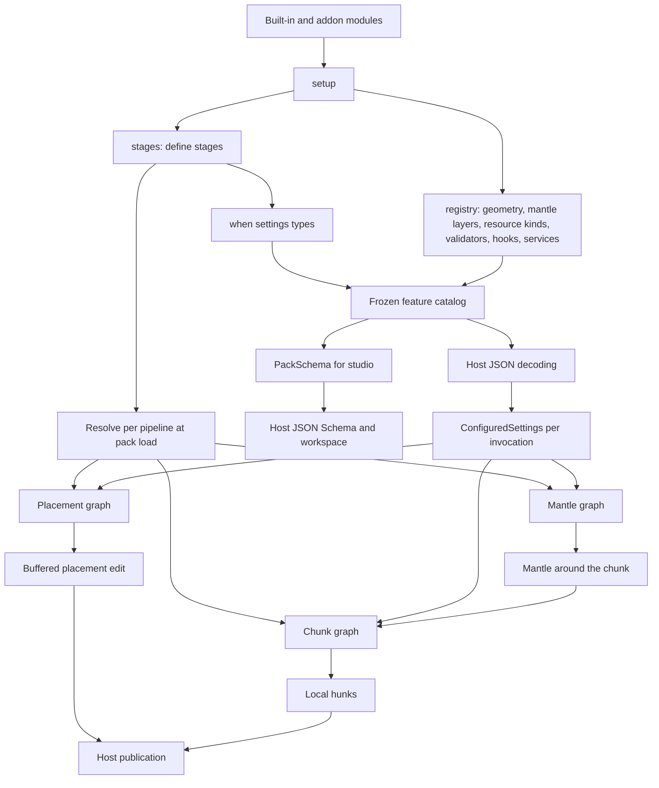

# Iris API design

Status: pack module loading (`LoadedPack`), the stage graph, per-stage random streams, both
pipelines' reference executors, settings catalog and its description for studio, geometry,
resources, module resource kinds, validators, per-world state, lifecycle hooks, services and typed storage contracts
exist and are tested without the Iris
engine. Provider and runtime families at the end are design notes, not Java interfaces.

## Model

An Iris module owns its settings types and the stages that act on them. The host owns resource
loading, platform adapters, scheduling, storage and publication. The core engine is meant to be
a set of ordinary modules (`iris:prepare`, `iris:anchor`, `iris:blocks` and so on). No stage,
phase or hook has special status in the API.



## Module loading

The `IrisModule` implementation is the module's entry point. `info()` returns its id, display
name and version; there is no separate descriptor. What the jar needs at load (its optional packages) is in the jar's
manifest, because it is the jar's, shared by every module in it, and because a module's identity should not carry
class loading mechanics. A pack keeps its modules in
`<pack>/modules/*.jar`, one or more modules per jar.

The host loads a pack with `LoadedPack.load(packRoot, host)`. `ModuleHost` is the host's fixed
configuration, built once and the same for every pack: built-in modules, exposed host packages,
the JSON fields the host uses itself, host type packages and reserved folders. Each of its methods adds to what earlier calls
configured, and all names are checked when it is built. `LoadedPack` runs `PackModules.load` (below), then
`LoadedModules.load` on the built-ins followed by the pack's modules. If the second step fails it
closes the first before rethrowing, so a failed load leaves no class loader or jar copy behind.

Every load error is one unchecked type, `ModuleLoadException`, with `moduleId()` and `origin()` when the error is
one module's or one jar's. Jar errors throw it directly with the jar. Anything a module's `setup` throws, the
registry's and stage graph's checks included, is wrapped with that module's id and jar, the message unchanged; errors
after setup (catalog, studio description, resolution) are wrapped without a module unless the check knows the stage's
module. So hosts catch `ModuleLoadException` instead of `RuntimeException`, and a bug in the host itself still
surfaces as what it is. `ModuleHost`'s own argument checks stay `IllegalArgumentException`: they are the host's
configuration, not a pack's.
`close()` closes the pack's class loader, then deletes its jar copies.

A jar names its entry classes, one per line, in `META-INF/services/com.volmit.IrisModule`, the
provider format of `ServiceLoader`. The host reads that file from the jar itself rather than calling
`ServiceLoader`, which would also return providers of parent class loaders and could not say
which jar a broken provider came from. The rejected alternatives:

- A manifest attribute such as `Iris-Module: com.example.MossModule`. It needs the same reading
  code but is not a Java convention, IDEs do not check it, and fat-jar tools tend to rewrite
  manifests.
- A descriptor file with id and version. It duplicates `info()`, so the two can disagree, and
  parsing it needs a format the JDK does not ship.

`PackModules.load(packRoot, exposedHostPackages)` (or `load(packRoot)`, which exposes only the
API):

1. Validates the exposed packages. The API's package is always one of them.
2. Lists regular files ending in `.jar` in `<pack>/modules`, sorted by file name. A missing
   directory means no modules.
3. Copies them into a fresh temporary directory (see "Jar copies"). Every later step reads the
   copies; messages name the originals.
4. Reads each jar's entry point file, its class files and its manifest's tooling parts (see "Tooling parts"). Comments
   (`#`) and blank lines are ignored; zero entry class names fail, several load in the order listed.
5. Fails if a jar holds a class of an exposed package, naming the jar and the first such class.
6. Fails if a class is in two jars, naming the class and both jars.
7. Resolves every class each class uses (see below). A class that Iris has but hides, a class of a
   JDK module packs cannot see or of a JDK package packs may not use, or a class missing from an
   exposed package fails the load, listing
   each referencing and referenced class per jar and kind. Classes that nobody has are collected
   per jar. Generation code that uses a tooling part's class fails too; the classes of a part are judged apart, or
   skipped (see "Tooling parts"). Nothing has been defined up to here.
8. Creates one `URLClassLoader` for all copies, parent = `ExposedHostClassLoader`.
9. Loads each entry class, checks that it implements `IrisModule` and comes from its own jar,
   instantiates it with the public no-argument constructor and calls `info()`, once.
10. Drops each jar's missing classes that lie in the optional packages its manifest declares
   (`Iris-Optional-Packages`; an invalid name fails the load when the jar is read, in step 1).
11. Logs one INFO summary of the pack's modules, and one WARNING if any missing classes remain.

Any failure after step 3 closes the loader, if it exists, and deletes the copies.

One loader per pack, not per jar, because `requires(...)` takes another module's stage constant.
A pack jar that requires a stage of another pack jar must see its classes. Packs stay isolated
from each other. The cost is a shared class namespace: with two copies of a class, the loader
would silently use the one first in file name order. Step 6 turns that into a load error, so two
jars that shade the same library must relocate it, and shared code belongs in one module that the
others require.

### Jar copies

A `URLClassLoader` keeps every jar it reads open until it closes. On Windows an open file cannot be
replaced, so a loaded pack would stop its module author from rebuilding a jar while studio runs.
The load therefore copies the jars first (`JarSnapshot`) and gives the class check and the loader
only the copies. The originals are closed again as soon as they are copied. This also means a load
works on one consistent set of jars: a jar rebuilt during the load affects the next load, not half
of this one.

Copies live in a new directory `iris-pack-modules-*` under `java.io.tmpdir`, or under the directory
the host passes to `ModuleHost.copyingJarsTo(...)`, which is created when missing, named by their
original file name, next to an owner file holding a fixed header and the id of the process that made
it. Origins and messages always use the original path relative to the pack: the copy's path would
mean nothing to the author. When an entry class turns out to come from another jar of the pack, the
message names that jar's origin too.

A process that crashes never closes its packs, so its copies stay. A later load removes such a
directory only when it can show that this code made it and that nobody uses it: the name has the
prefix, the owner file has the header, its process no longer runs
(`ProcessHandle.of(pid)` finds no live process), and the directory holds nothing but the owner file
and `.jar` files. Directories of a process that still runs, including another server sharing the
temporary directory, are left alone; a reused process id can only keep a stale directory, never
remove a live one. A crash between creating the directory and writing the owner file leaves an
empty directory that is never removed, because nothing proves who made it.

The class check reads jars the way the loader does. `module-info.class` is ignored. A
multi-release jar (`Multi-Release: true`) contributes each class once, under its base name, from
the highest `META-INF/versions/N` that the running JDK selects; a versioned copy of a class in one
jar therefore clashes with the plain class in another. In a jar without that manifest attribute the
loader never reads `META-INF/versions`, so those entries are skipped.

### What a module can see

Modules depend on the Iris API. They compile against it `compileOnly` and never ship it, because
Iris provides it at runtime; in production it is shaded into the Iris plugin jar. That loader also
holds Iris internals and the libraries Iris bundles, so it is not the pack loader's parent.
`ExposedHostClassLoader` is: it delegates every class in an exposed package, and its subpackages,
to the host's loader (the loader that defines the API) and everything else to the platform class
loader, which holds the JDK.

The host side, `com.volmit.host` (with `com.volmit.host.schema`), is never exposed, although it lies inside the
API's root package. It is its own Gradle subproject and artifact (`host`, `com.volmit:iris-host`) next to the API
(`api`, `com.volmit:iris-api`); Iris depends on both and shades both. `ExposedPackages` carves the host package out
of every exposed package (`com.volmit` and anything the host passes), and the host may not expose it explicitly. A
pack class that references a host class is therefore a hidden host class and fails the load, and a jar that ships a
class anywhere under `com.volmit`, the host side included, fails as shipping API classes.

*Why keep the name `com.volmit.host`.* The finding allowed a new root such as `com.volmit.hosting`, but any name
under `com.volmit` would be exposed as well, and a root outside it (`com.volmithost`) reads like a different
vendor. The exposure check can exclude one package exactly, so the carve-out is a single rule in one class, and no
import in Iris or the tests changes.

The platform loader provides the JDK modules defined to it and to the boot loader: `java.base`,
`java.sql`, `java.net.http`, `java.compiler` and the other standard modules. JDK modules defined to
the application loader, such as `jdk.compiler`, `jdk.jshell` and `jdk.attach`, are not available
to modules, and neither are JDK modules the runtime did not resolve.

Seeing a class is not enough to use it. Pack classes live in their loader's unnamed module, and a
JDK module lets an unnamed module use only the packages it exports to all unnamed modules. Internal
packages such as `jdk.internal.misc` (`jdk.internal.misc.Unsafe`) are not, so code using them would
fail with `IllegalAccessError` when it runs. Packages exported only to named JDK modules (qualified
exports) count as not exported. The supported way to use Unsafe is `sun.misc.Unsafe`, which
`jdk.unsupported` exports. A server started with `--add-exports <module>/<package>=ALL-UNNAMED`
exports that package to every unnamed module, and then modules may use it.

The exposed packages (`ExposedPackages`) are the API's package, `com.volmit` (the package of
`IrisModule`), plus whatever the host passes to `ModuleHost.exposing` (and so to `PackModules.load`). The host decides those; the
intended use is the packages that hold built-in modules' stage constants, so that a pack jar can
`requires(...)` a stage of the core engine or a built-in feature. A pack jar then links against
the host's class and the same stage constant, which resolution requires: a copy would be a second
definition of the id. Names match whole packages: `com.volmit` does not expose `com.volmitx`. A
trailing dot is accepted; anything that is not a package name, such as a blank string or a
wildcard, is rejected. The host's `PackageName` holds these rules; a jar's optional packages use them too.

A module may use any library. A library the host does not expose it ships itself, inside its own jar or as another
jar of the pack, and never borrows the host's hidden copy: those can change with any host update, and two modules would
otherwise depend on whatever version the host happens to bundle. A host may instead expose a library it promises to
keep, by passing its packages to `ModuleHost.exposing`; the pack loader then gives modules the host's classes of it,
like the API's. Iris exposes VolmLib (`art.arcane.volmlib`, its utility library, shaded unrelocated) and Gson
(`com.google.gson`, which every platform it runs on provides), so Iris's built-ins and pack modules share one copy of
each. A module jar may not contain classes of an exposed library, as it may not contain API classes.

Resources follow the same rule by path: `com/volmit/...` and the paths of other exposed packages
from the host's loader, everything else from the platform loader, then the pack's jars. A class
and its class file come from the same place, and a pack never sees Iris's own resources such as
`plugin.yml` or its service files.

The pack loader asks its parent first, so a packaged copy of a host class would be silently
replaced by the host's, and a module class in an exposed package could be replaced by a later host
class of the same name. Step 5 rejects both; exposed packages belong to the host. For the API the
message points at `compileOnly`, the usual cause. A module class that shares a name with a hidden
Iris internal is harmless, because the pack loader cannot see it. A module class that shares a name
with a JDK class is replaced by the JDK's; that is not checked.

Step 7 reads every class file with the JDK's `java.lang.classfile` API. A class uses every class
in its constant pool (supertypes, and instantiated, cast, caught, called-on and class-literal
types) and every type in the descriptors of its own fields and methods and of the members and
call sites it uses. Arrays count as their element type; primitives do not count. Annotations and
generic signatures are left out: the JVM never resolves them while linking, and reflection skips an
annotation whose type is missing, so a `compileOnly` annotation library such as JetBrains
annotations needs nothing at runtime. Each used class outside the pack is judged by its class
file, so nothing is loaded or initialized:

| The class is | Result |
| --- | --- |
| in a package of a JDK module the platform loader provides, not exported to unnamed modules, such as `jdk.internal.misc` | load error: names the package and module; points to `sun.misc.Unsafe` and `--add-exports` |
| in a jar of the pack, an exposed package of the host, or the JDK | resolves |
| in an exposed package, but the host does not have it | load error: the jar was built against a different Iris API or Iris version |
| in a JDK module the platform loader does not provide, such as `jdk.compiler` | load error: names the JDK module, which is not available to modules |
| not exposed, but the host's loader has it (Iris internals, Iris's copy of a library) | load error: modules cannot use Iris's classes; ship the library in the pack or use the API |
| nowhere | the pack loads, with a warning unless the jar's manifest declares the package optional |

The rows are checked in that order. The export row comes first because access does not depend on
which loader finds the class: whoever loads `jdk.internal.misc.Unsafe`, `java.base` decides who may
use it. It asks the boot layer's `Module` objects whether they export the package to an unnamed
module that no export names (`Module.isExported(package, unnamedModule)`), so exports added with
`--add-exports ...=ALL-UNNAMED` count, exactly as they do at run time, and qualified exports do not.
Modules the platform loader does not provide are left to the unavailable-module row, so the two
never overlap. The unavailable-module row comes before the host row because the host's loader
can usually load application-loader JDK classes, which would otherwise be reported as hidden Iris
classes. Whether a class belongs to such a module is decided by its package, from the JDK's module
descriptors (`ModuleFinder.ofSystem()`) and the loader the boot layer gives each module, so nothing
is loaded. When a jar uses several kinds of unusable class, the error has one group per kind and
jar, each with its own advice.

The JVM resolves a class only when code first needs it, so a class that nobody has is usually an
optional dependency of a bundled library, used only when present. Rejecting those would be stricter
than the JVM and would make many ordinary libraries unusable. Instead the pack loads,
`PackModules.missingClasses()` lists the missing classes per jar (`MissingClasses`), and the load
logs one WARNING for the pack, one line per jar with at most five class names
(`MissingClassesWarning`), so a large shaded library cannot flood the log. Code that needs a missing
class throws `NoClassDefFoundError` when it runs; the verifier may also need it while linking a
class that uses it, which then fails when that class is first used.

A jar that knows it uses such classes declares their packages as optional in its manifest, separated by spaces or
commas:

```
Iris-Optional-Packages: org.slf4j org.apache.logging.log4j
```

Each package covers its subpackages. Missing classes of that jar inside them are dropped from the
warning and from `missingClasses()`; the rest still warn, and other jars of the pack are not
affected. A jar with several modules declares once for all of them. Invalid names fail the load
when the jar is read, naming the jar.

The declaration lives in the manifest because it is about the jar, not about any one module: a jar shades a
library for all of its modules, and the host already applied the declarations per jar. It used to be
`ModuleInfo.withOptionalPackages`, which put class loading mechanics into a module's identity and could only be
read once the entry classes were defined. The declaration only removes warnings. Every load error is decided in
step 7, without it, so a declared package can never turn a hidden Iris class, an unavailable or non-exported JDK class
or a class missing from an exposed package into a pass. `missingClasses()` drops the excused classes instead
of flagging them: it then says exactly what the warning says, and a class the author declared
expected is not a problem to show in studio.

A class the host hides fails, even though the pack might never run that code, because it exists:
the module was written against Iris's copy, and the error says to ship the library or use the API
instead of leaving the author with a `NoClassDefFoundError` during setup or generation.

There is no version gating. Packs ship their module jars and Iris never downloads any, so whether
a jar works with the running Iris is the pack publisher's responsibility. The class check catches
API and exposed classes that no longer exist. It does not check methods and fields: a jar built
against an API whose methods have changed fails with a linkage error, which `LoadedModules.load`
reports with the module's jar when it happens during setup, and which surfaces at generation
time when it happens only in a stage body.

Closing `PackModules` closes the loader and then deletes the copies. Classes loaded before that
keep working, so the host must drop everything built from the pack first.

Each module reaches `LoadedModules.load` as a `DiscoveredModule`: the module, its `ModuleInfo` and
its origin, the jar path relative to the pack or "host classpath" for built-ins. `info()` is called
exactly once, when the module is discovered (`DiscoveredModule.builtIn`, or step 9 for a jar), and
everything afterwards uses the stored value, so a module whose `info()` changes between calls cannot
give the host two answers. Errors about a module name its origin. Every jar error names the jar.

### Tooling parts

A module's platform tooling (the Bukkit studio, importers that read the server's structure files) cannot live in the pack
loader, which cannot see the platform: step 7 rejects every class Iris's loader has but does not expose, and Bukkit is
one. It also must not run on every server. The jar therefore names each part's entry class per platform in its manifest:

```
Iris-Tooling-Parts: bukkit=art.arcane.iris.tools.bukkit.StudioPart bukkit=art.arcane.iris.tools.bukkit.ImportPart
```

A part is the entry class's package with its subpackages. Entries of one platform may repeat, even in one package; any
other overlap fails when the jar is read (step 4), as does a malformed entry or an entry class the jar lacks, so no class
is ever in two parts. The manifest is right for the same reason as `Iris-Optional-Packages`: the declaration decides
which loader defines a package, which is class loading mechanics of the jar and not a module's identity. The rejected
alternatives: a service file per platform cannot name a package, and the class check needs the partition before anything
loads; an annotation means scanning every class; a second jar per platform makes a module two artifacts and the pack
loader would still have to skip it.

**The class check partitions the jar** (`ToolingPartition`, used by `PackReferenceCheck`):

- Generation classes are checked as before, and may not use a part class of any platform. The failure names both classes:
  "Generation code cannot use the bukkit part; move the call into the part."
- Part classes are not generation code. When the host runs on a platform (`ModuleHost.runningOn(PlatformApi)`), that
  platform's parts are checked at pack load, so a broken part fails early while its class still loads lazily. The check
  takes what a part may see: its own packages, generation classes, the platform's api packages (which must exist in the
  platform's loader), and whatever generation code may see. Denied packages fail first: a part may not use Iris
  internals, the server's own classes or the host, or another part's classes. A class the host exposes to modules is
  never denied, which is how `art.arcane.iris.builtin` stays usable inside the denied `art.arcane.iris`.
- Parts of other platforms are skipped unread, as are all parts when the host runs on no platform. `ModuleJarCheck`
  does the same at build time, with `--platform=<name>:<platform api jar>` standing in for the platform's loader.

`ToolingPlatform` describes a platform as a value: its name, the package prefixes of its api and the denied prefixes.
`ToolingPlatform.BUKKIT` is Paper's. `PlatformApi` pairs it with the loader that holds the api classes, which the check
asks by class file, so nothing loads.

**`ToolingPartLoader`** is a child of the pack's loader, one per part. It defines the part's own packages itself, child
first, from the same jar copy; refuses denied packages with a `ClassNotFoundException`; hands the platform's api packages
to the platform's loader; and asks the pack's loader for everything else. Being a child of the pack's loader is the point:
the part then gets the same `Class` objects the modules registered, where a sibling loader would turn a resource the jar
defines into a `ClassCastException`. The caller opens and closes it; closing it never closes the pack's loader.

`ExposedPackages` carves out every `com.volmit.tooling.<platform>` package like `com.volmit.host`: only a part sees a
platform's tooling api. `com.volmit.tooling` itself, the neutral api, stays exposed. Enabling parts lazily, mounting their
commands and listeners, and disabling them belongs to the platform adapter, not to the host.

### Namespaces

A module owns its id: `ns:name`, with no `/` in the name. It may define only stages whose ids start
with its id and `/` (`iris:stilt/fill`), so no module can define stages under another module's
path, and a stage id names exactly one possible owner. A `/` in a module id would let `iris:stilt/x`
define stages under `iris:stilt`, so `ModuleInfo` rejects it.

Feature ids of geometry generators and mantle keys a module registers follow the same rule
(`ModuleInfo.ownsId`): they are the module id or start with it and `/`, such as `iris:snow` or
`iris:snow/depth`. Sharing the namespace is not enough, or `iris:snow` could claim `iris:stilt`'s
ids. A settings type named in `when(...)` must have a feature id that at least one module naming it
owns in this sense: its owner. Other modules may name it too, to run only where that setting is
configured. Checking against the module that names it alone would forbid that; checking nothing
would let any module claim another module's settings id.

No namespace is reserved: `iris` is as free to a pack module as any other. A host that ships
modules of its own protects nothing by a reservation, so a module id is only ever loaded once: a
second module with the same id fails the load wherever it comes from (one jar, two jars, the host's
built-ins), naming both the origin and the class of each. That one check is what keeps a built-in
module that moves into a pack jar from being loaded twice.

The load summary and the missing-classes warning go to the `System.Logger` the host passes to
`ModuleHost.loggingTo(...)`, by default `System.getLogger(PackModules.class.getName())`. A host
argument rather than a `System.LoggerFinder`: the JDK finds a finder through the system class loader,
which a plugin's classes are not on. The summary lists display name, id, version and jar for each module in load
order, or says the pack has no module jars. `PackModulesSummary` and `MissingClassesWarning` build
the texts and are tested on their own.

## Stages

A stage is a constant created by `Stage.placement`, `Stage.placementBlock`, `Stage.chunk` or `Stage.mantle`. Its
identity is that object. Another module that wants to depend on it references the owner's
constant, which makes the dependency a compile-time one. A copy with the same id is rejected at
resolve time.

| Stage type | Pipeline | Runs | Context |
| --- | --- | --- | --- |
| `PlacementStage<O>` | PLACEMENT | once per placement attempt | `PlacementStageContext` |
| `BlockStage<O>` | PLACEMENT | once per object block, in a block pass | `BlockStageContext` |
| `ChunkStage<O>` | CHUNK | once per chunk invocation | `ChunkStageContext` |
| `MantleStage` | MANTLE | once per chunk, before the chunks it reaches generate, each stage its own pass | `MantleStageContext` |

`StageGraph.define` returns one definition type per stage type: `PlacementStageDefinition<O>`,
`BlockStageDefinition<O>`, `ChunkStageDefinition<O>` and `MantleStageDefinition`. Each offers only
what its pipeline allows, so these rules are compile errors instead of load failures: a chunk
stage has no `reach` or `writesMantle`, only a mantle stage has `reach(PackReach)`, and only a
block stage has `accumulate`.

Rules enforced by `StageGraphBuilder` and the resolver:

1. The stage id must start with the defining module's id and `/`. A second definition of an id
   fails. Two modules with the same id fail.
2. `requires(stage...)` adds a REQUIRED edge. If the stage is not defined by any module, loading
   fails with both stage ids, the requiring module and the namespace the missing module should have.
3. `softAfter(...)` and `softBefore(...)` take stage constants or `StageRef` ids and add SOFT edges
   only when the referenced id is defined. Absent targets are kept for diagnostics. A module cannot
   force itself before another module's stage with a hard edge.
4. A stage with output must be defined with `produce` (or `accumulate` for block stages), and a
   stage without output with `run`. Every defined stage needs exactly one body before its
   module's `setup` returns.
5. A stage and everything it references must be in the same pipeline, soft references included.
6. Cycles fail and print the whole cycle: each stage with its module and the kind of each edge.

### Order

Resolution is Kahn's algorithm over the pipeline's stages. Among stages whose predecessors have
all run, the lexically smallest id goes first, with one refinement for fusion:

- while a block pass is open, a ready block stage continues it;
- otherwise a ready invocation stage runs first;
- otherwise a block stage opens a new pass.

The result depends only on ids and edges, never on setup order. A tie-break on raw lexical id
alone would interleave unrelated invocation stages into block passes and split them. Note that
no topological order can put every unordered pair in lexical order once edges point against the
alphabet, so "lexical" here always means "lexical among ready stages".

### Block passes

Adjacent block stages in the resolved order form one block pass. The placement runner loops over
the request object's blocks once per pass and runs every active stage of the pass on a block
before moving to the next block. A block stage that requires another block stage runs after it
for the same block. An invocation stage between two block stages splits the pass, even when it
is inactive for a particular invocation. The split is static so that `describe()` matches what
runs.

Each pass starts from the request object's blocks. `replace` and `skip` affect only later stages
of the same pass for the same block. Work that later passes need belongs in an accumulator.

### Outputs

Outputs live in a per-invocation array indexed by resolved position. Stage definitions never hold
them. `ctx.output(stage)` scans the current stage's precomputed list of transitive requirements by
identity, which is a handful of entries, then reads the array. There is no hashing per call.
Reading anything outside that list throws `IllegalStateException` and names the fix. A block
stage's accumulator is created once per placement and becomes readable when its pass ends;
reading it from inside the same pass throws. A null output from a stage that declares one fails
the invocation, unless the stage rejected the placement attempt. These checks run when a stage
reads or produces, not at load: the graph knows which outputs a stage may read, not which it does.

### Activation

The graph is resolved once per pack load. Activation is decided per invocation:

1. The invocation gets `ConfiguredSettings`: for each settings type, the entries configured for it, in
   level order. For a placement the host passes the placement's own declarations. For a chunk or mantle
   invocation the runner asks `FeatureSettings.declaredInChunk` for each conditioned type: every distinct
   entry, by level and source, of the chunk's 16 by 16 columns. Its default reads every column; a host
   that knows the regions and biomes of a chunk answers from those instead (Iris does).
2. The invocation looks up each distinct `when` type once.
3. One pass in resolved order marks a stage active when its settings have an entry (or it has no
   condition) and every stage it requires is active.

So an inactive requirement deactivates its dependents. That is not an error. Soft edges never
affect activation. The cost per invocation is two small arrays and one pass over stages and
REQUIRED edges, plus, for chunks, one `declaredInChunk` per conditioned type. The body reads
the entries with `ctx.configured(type)`, a never-empty `SettingsStack<S>`. Only the
stage's own `when` type is readable that way; any other type, or a stage without a condition,
throws and names `when(...)` and `settings()` as the fixes. Bodies take only the context, so one
definition type per pipeline covers conditioned and unconditioned stages alike.

`ConfiguredSettings` groups a value under the class whose `@Feature` declares it: the value's class or
its nearest superclass that carries the annotation. So a subclass value is found by `when(Base.class)`,
and a placement that configures a base and a subclass value configures the type twice.

A chunk stage is active when any column of the chunk configures it, so a biome border inside a chunk
never hides a feature on either side. The body then reads `ctx.settings().at(type, x, z)` per column,
or at the chunk's centre column (`ChunkContext.centreX()`/`centreZ()`, local 7, 7) for behaviour that
happens once per chunk. `ChunkContext`, shared by chunk and mantle contexts, also names the chunk
(`chunkX()`, `chunkZ()`) and its `area()`, so no module hand-builds chunk boxes or shifts by 4.

### Settings levels

Settings are declared at levels (`com.volmit.config.Level`): `DIMENSION`, `REGION`, `BIOME` (the
column's surface biome) and `PLACEMENT`. `@Feature(targets = ...)` names the levels a type may be
declared at, and the same enum orders the entries. `FeatureSettings.at(type, x, z)` returns a
`SettingsStack`: one entry per level that declares the type at that column, in that order, each with its
level, the declaring resource and the value. Levels stack: there is no "most specific wins" and no field
merge. A module decides what several entries mean: deposits run once per entry (`values()`), a surface
block may take the most specific (`mostSpecific()`), a dimension-wide setting reads `dimension()`. The
stack offers those picks so modules do not each write their own; it never merges. The alternatives each hide a decision from
the module: overriding would make a biome's deposits silently drop the dimension's, merging would need a
rule per field. Something spanning several columns reads at one origin column: per chunk the centre
column, per placed object the column it is anchored at. Cave biomes are not a level.

### Diagnostics

`ResolvedGraph.describe()` lists every stage in order with its kind, block pass, owner module,
`when` feature, required and soft predecessors and absent soft targets. It also lists the fused
block passes and every pair of stages with no path between them in either direction. Those pairs
are ordered only by the tie-break, so they are where two modules can silently conflict.
`stages()`, `blockPasses()` and `unorderedPairs()` expose the same data as values.

## Placement attempts

A module places an object through the pack's placement graph with `PackWorld.placements().place(PlacementRun)`; the
host runs `PlacementRunner` over an edit that buffers into the run's `PlacementTerrain`, and returns the API
`PlacementOutcome`. One service, one request and one outcome: the run carries the object, its display name, the
placement as the pack wrote it (JSON, from which the host reads the settings other modules declare at `Level.PLACEMENT`),
the area, the terrain, the placing module's own input and the seed, and nothing names a host. The module that owns the
placement type declares it with `registerPlacementType(type, jsonFields)`: its option names are reserved at the placement
level, as the host's own fields are at the others, and studio adds the placement-level settings to the type's schema. The
host decodes the placement JSON once per text. A placed object is remembered by a `PlacementRecord` (object id, the
module's placement number, optional structure id) that the terrain keeps beside the blocks and `RunningWorld.placementAt`
reads back; the host stores it in its own form. The terrain is an interface so a module can hold
writes (an island that only accepts blocks over itself, a cave that keeps an object inside it) and commit or drop them
as one; the host's terrain for a mantle invocation is `MantleGenerationContext.placementTerrain()`. Objects come from
`PackResources.objects()` (`PackObjects`), which loads, scales and builds them per pack snapshot.

`PlacementRunner.place(request, edit, inputs, invocationSeed, settings, timings)` owns the edit. It runs active stages in
order, stops after the current stage or block once a stage calls `reject(reason)`, commits only
when nothing rejected or threw, and closes the edit in every case. A producer that rejects may
return null, since no later stage reads its output; a null output without a rejection fails the
attempt. Stages receive a buffered
`PlacementAccess` view of the edit without commit or close, and it expires with the attempt.

`PlacementAccess.set(x, y, z, state)` is the per-block write: a placement writes thousands of blocks, and the record
form (`set(PlacedBlock)`, for a block entity) costs a position, a record and an `Optional` per block. The edit
implements both, so a host buffers a plain block as it likes (Iris keeps states and block entities in separate maps,
so a plain block costs only its position key; an index into the placement area does not work, because a placement's
area may be unbounded). The access view, its mantle view and that mantle's layer views are made once per attempt, as
the chunk runner's mantle view is once per chunk invocation; asking again returns the same object.

## Random streams

Every stage has its own random stream per invocation, `StageContext.random()`. There is no shared
stream: `InvocationContext` has no `random()`, and the host passes a `long` invocation seed to
`PlacementRunner.place` and `ChunkRunner.generate` instead of a generator stages could see. With one
shared stream, every draw of an earlier stage shifts what later stages get, so installing a module
would change other modules' output for the same seed.

The stream depends only on the invocation seed and the stage id (`StageStreams`):

1. `idHash` = 64-bit FNV-1a of the UTF-8 bytes of `namespace:path`, computed once per pack load;
2. `streamSeed` = `mix(mix(invocationSeed) ^ idHash)`, `mix` being the SplitMix64 finalizer
   (Stafford variant 13);
3. the stream is `new WorldRandom(streamSeed)`, created when the stage first draws.

`mix` is a bijection, so a stage gets a different stream for every invocation seed, and in one
invocation stages with different id hashes get different streams. The hash and the mixer are written
out in IrisApi, not taken from `String.hashCode` or a JDK class whose output may change.

A test pins the derivation to values computed outside Java from this description.

### WorldRandom

`com.volmit.random.WorldRandom` is the generator stages and object generators see. No JDK generator
fits: `SplittableRandom` and the `RandomGeneratorFactory` algorithms promise identical sequences only
within one program, and `java.util.Random` fixes only some methods. The ones it inherits from
`RandomGenerator`, such as `nextInt(origin, bound)`, `nextDouble(bound)` and `nextExponential()`, are
JDK defaults that a JDK update may change, and those are the ones module authors reach for.
`Random` is also a 48-bit LCG with an atomic update per draw, a cost in per-block stages.

`WorldRandom` therefore does not implement `RandomGenerator`. Overriding every default would hold
only until a JDK adds another one; a type of its own exposes nothing IrisApi does not define. The
price is that it cannot be passed to JDK methods that take a `Random` or `RandomGenerator`, such as
`Collections.shuffle`; `pick` and `shuffle` cover the list cases instead. Its methods:

| Method | Definition |
| --- | --- |
| `nextLong()` | SplitMix64 (Steele, Lea and Flood): `state += 0x9e3779b97f4a7c15`, return `mix(state)` |
| `nextInt()` | the high 32 bits of `nextLong()` |
| `nextBoolean()` | whether `nextLong()` is negative |
| `nextFloat()` | the high 24 bits of `nextLong()` times 2^-24, in `[0, 1)` |
| `nextDouble()` | the high 53 bits of `nextLong()` times 2^-53, in `[0, 1)` |
| `nextInt(bound)`, `nextInt(origin, bound)`, `nextLong(bound)`, `nextLong(origin, bound)` | Lemire's multiply-and-reject method, unbiased; ranges wider than `MAX_VALUE` work |
| `nextDouble(bound)`, `nextDouble(origin, bound)` | `origin + nextDouble() * (bound - origin)`, a result rounded up to `bound` replaced by the double below it; a width beyond `Double.MAX_VALUE` is halved first |
| `nextGaussian()` | Marsaglia's polar method on `StrictMath.log` and `StrictMath.sqrt`; the pair's second value is discarded |
| `chance(probability)` | `nextDouble() < probability` |
| `pick(items)` | `items.get(nextInt(items.size()))`; an empty list throws |
| `shuffle(items)` | Fisher-Yates in place: for `i` from `size - 1` down to `1`, swap `i` with `nextInt(i + 1)` |

The state is one `long`, initially the seed. Methods without rejection draw exactly one value; how
many values a method draws is part of the sequence. `StrictMath` is fixed bit for bit by the Java SE
specification (fdlibm), so the gaussian needs no math of its own. Invalid bounds (`bound <= 0`,
`origin >= bound`, NaN or infinite doubles, a probability outside `[0, 1]`) throw
`IllegalArgumentException`, as does `pick` on an empty list. `pick` draws what `nextInt(size)`
draws. A shuffle of `n >= 2` elements makes `n - 1` `nextInt` calls; a shorter list draws nothing
and is not touched. `RandomAccess` lists are swapped through `List.set`; other lists are copied to
an array, shuffled there and written back through their `ListIterator`, like `Collections.shuffle`,
with the same result. A list that does not support `set` throws its `UnsupportedOperationException`
before any element changes. Weighted picking is left out until a stage needs it. The generator is
not thread-safe: one stage uses its stream within one invocation.

`WorldRandomTest` pins every method to values computed by `src/test/reference/world_random.py`, an
independent implementation of this table with Python integers and IEEE doubles. Python's `math.log`
is the platform's, so the script carries a port of fdlibm's `log`. The build does not run it. The test
also fails if `WorldRandom` gains a public method without pinned values or implements
`RandomGenerator`.

A block stage gets one stream per placement and draws from it across the blocks of its pass in block
order. Fused block stages interleave per block, but each still draws only from its own stream. A
stage that never draws never creates its stream.

## Coordinates

X and Z are world coordinates. Y is the height above the dimension's bottom: 0 is always the dimension's
bottom block, whatever its minimum height is in the platform, so Y is never negative. That applies to
every value that carries a height: `TerrainSample` heights, `TerrainSampler` and `BlockView` positions and
bounds, `PaletteSampler` and `NoiseSampler` sample positions, `PlacedBlock` and `PlacedMarker` positions,
placement anchors, `Mantle` positions and bounds, and a chunk `Hunk`'s local y. `BlockBox` carries
whichever coordinates its owner defines; an object's bounds are local to the object, and a placed
footprint can extend below height 0 where the object overhangs the bottom. The host converts to and from
the platform's Y at its boundary.

## Chunk invocations

`ChunkRunner.generate(inputs, invocationSeed, timings)` runs active chunk stages once each in resolved order.
`GenerationContext.blocks()` returns the host-owned local volume of the chunk's blocks, shared by
all stages of the invocation. Hunk coordinates are local. Samples and mantle coordinates use
world X and Z, and Y as the height above the dimension's bottom. A chunk stage writes only its own chunk and reads the mantle: the runner hands it a view
whose writes throw. The runner does no neighbor scheduling or rollback. A failed invocation must stop
the host from publishing the chunk.

A chunk stage writes only its chunk but may look around it: its `TerrainSampler` covers the chunk and the 16 blocks
around it, so a stage that smooths a surface reads its neighbors' heights (`surfaceY`, which spares the host the slope
that `column` works out, or `surfaceHeight`, the same height rounded to a block, which every stage placing on the
surface used to write out as `(int) Math.round(surfaceY(x, z))`). The sampler also gives the dimension's
`fluidHeight()` and, per column, `upperDimensionY` where a dimension stacked above begins; a stage writes nothing at or
above it. The mantle's `blocks()` are the blocks placements wrote into the mantle for chunks to take over (objects,
structures): a chunk stage copies them into its chunk, as Iris's `iris:matter` does. They are the host's layer, so they
need no registration, and stages only read them; placements keep writing blocks through `PlacementAccess.set`.
A mantle stage's `TerrainSampler` covers the same margin (at least 16 blocks, more when its reach is larger): a carver blends
the profiles of the columns around its chunk, so it reads their heights and biomes though it writes only the mantle.
All three runners take a `StageTimings` and report how long each stage that ran took, so the host times modules
instead of modules timing themselves. A block stage is reported once per placement, its time summed over the blocks
of its pass; an inactive stage or one that throws is not reported.

The ground a chunk stage fills in needs more of the host than heights. `surfaceBiome(x, z)` answers the biome id of a column without working out the
cave biome; `surfaceKind` says what that biome was generated as (land, sea or shore; a cave biome is always `CAVE`), `surfaceBlock` the block an image
map gives the ground, `minWorldY` the world Y of the dimension's bottom (settings that name world heights, such as a deposit variant's band, are in it), and
`upperDimension()` the dimension stacked above, whose own settings (`UpperDimension.settings()`), resources and image-map blocks decide what its ground is
made of. A biome that is no column's surface biome, such as the cave biome of a `BiomeSample`, has its settings through `FeatureSettings.declaredBy`.
The chunk stage's mantle covers the chunk and the 16 blocks around it like the sampler, so a decoration that attaches to a neighbor sees the blocks
placements planned there. It writes registered layers inside the chunk's own 16 by 16 columns only: the mantle pipeline has finished around the
chunk, and a neighbor may already be generated, so its mantle stays as the pipeline left it (a write outside throws, naming `Stage.mantle`).
`Mantle.carved()` is the host's layer of carved voids (`CarvedVoid`: what fills the void, `OPEN`, `FLUID`, `LAVA` or `AIR`, and optionally the
biome it shows), as `blocks()` is its layer of planned blocks. It is the one host layer a module writes: a mantle stage plans the voids
(Iris's cave carver does, thousands per chunk, so the plain fills are shared constants and the host keeps them in its own form), and a chunk
stage reads them, around its chunk as far as its mantle reaches, and cuts them out of its terrain. A chunk stage's writes throw, as the
mantle is complete when chunk stages run. A void the planner marked need not show in the chunk (under a dimension above, the cave stage
leaves it solid), so `Mantle.isCarved(x, y, z)` stays as the short question for a stage that places something solid.
`Mantle.setPlatformBiome(x, y, z, biome)` is the other way round: modules write it and only the host's biome pass reads it, in the host's own form
(Iris stores the platform's id for the biome), so it is a write rather than a layer a module could read back. It is general rather than a
floating-island call: any stage that makes a block belong elsewhere, such as an island floating over another biome, can set the biome it shows.
`TerrainSampler.biomeHeight` and `skyBiome` answer for a biome that need not stand at the column, because such a stage builds that biome's ground
away from where the layout puts it. Neither takes a random: Iris picks sky and custom biomes with a generator seeded from the world's biome seed.
`BlockRegistry.oreFor(rock, ore)` is the platform's answer to which variant of an ore belongs in a rock.

## Mantle invocations

Some work writes beyond its chunk: a carver whose tunnels cross chunk borders, a vein running on into
the next chunk. A chunk stage cannot do that, because the host may already have generated the
neighbor. Such work is a mantle stage. `MantleRunner.generate(stage, inputs, invocationSeed, timings)` runs one
mantle stage for one chunk, if it is active there, against the mantle around it
(`MantleGenerationContext`: origin, terrain, settings, mantle), without a block hunk.

Every mantle stage is its own pass. Before a chunk generates, the host runs the first stage in resolved
order for every chunk within that stage's reach plus the reach of every later stage, each chunk once,
then the next stage the same way. A stage therefore sees, in the chunks around it, everything earlier
stages wrote, and a chunk's mantle is complete when its chunk stages read it. In Iris each mantle stage
is one mantle component, a pass of its own, whose radius is the stage's reach. Because stages of one
chunk run in different invocations, mantle stages have no outputs: `MantleStage` is not generic, and
stages pass data on through mantle layers. `requires(...)` still orders mantle stages and still
deactivates a stage in a chunk where a stage it requires is inactive; the runner works that out from
the settings of the stage and everything it requires, and collects only those.

The mantle pipeline is the only place that writes the mantle during generation, and mantle and chunk
pipelines meet only through mantle layers: an edge between them is a cross-pipeline edge and fails the
load. A mantle stage may rely on what earlier stages wrote around its chunk, but not on what a stage of
its own pass wrote in other chunks: that depends on the order the host generates chunks in.

## Reach

A stage may write outside its footprint: a carver reaches into neighbor chunks, a tree's leaves spread
past the object's trunk. The host has to prepare that area, and the mantle in it, before the stage
runs. Stages declare it in their definition:

```java
graph.define(CARVE).reach(32).writesMantle(CaveModule.CAVES).run(CaveModule::carve);   // CARVE is a mantle stage
```

- `reach(blocks)`: how far, in blocks along X and Z, the stage writes blocks or mantle values beyond
  its footprint. The footprint is the chunk's 16 by 16 columns for a mantle stage and the X/Z bounds of
  the placed object for a placement or block stage. A chunk stage writes only its chunk, so
  `ChunkStageDefinition` has no `reach`. Whole
  columns: height is not limited, because Iris prepares chunks and mantle as full columns. Leaving it out means 0. Declaring it twice or
  negative fails during the module's setup.
- `reach(PackReach)`: for a mantle stage whose reach depends on the pack, such as the largest object
  or the longest vein any level configures. The host works it out once per pack load from
  `PackSettings`, every entry of a settings type the dimension and its reachable regions and biomes
  declare, and asks each stage with `ResolvedStage.reachBlocks(settings)`; a negative result fails
  there, naming the stage. Only `MantleStageDefinition` offers it: placement areas and chunks
  are sized without the pack's settings. It counts as declaring the reach, so it cannot be combined
  with `reach(blocks)`.
- `writesMantle(layers...)`: the mantle layers the stage writes. Every layer must be registered by
  some module with the same value type, or the pack load fails naming stage and layer.
  `ChunkStageDefinition` has no `writesMantle`.

Each resolved stage carries its `StageReach`. `ResolvedGraph.reach()` collects a `PipelineReach`:
the largest reach of the pipeline's stages, and per mantle layer the largest reach of the stages
that write it. Inactive stages count, because activation is per invocation and the prepared area is
decided once per pack load. A mantle pipeline with a reach worked out per pack has no such number, so
`reach()` throws there; the host sizes each mantle pass from its own stage instead. `describe()` lists
each stage's reach.

One number per stage, not per layer: a stage that writes two layers at different distances declares
the larger. The host can still size each layer's mantle from the per-layer maximum. Reads are not
declared separately: the host prepares the pipeline's reach around every placement, and each mantle
stage's own reach around its chunk, so a stage may read what others wrote that far out (for mantle
stages, see the ordering caveat under Mantle invocations). A stage that must read farther declares that distance
as its reach. Terrain samples are computed, not prepared, and need nothing.

## Settings, geometry and storage

Settings types implement `IrisFeature` and carry `@Feature` (namespaced id, display name, attachment targets). `when(type)` validates the annotation during the module's setup. The id
must be owned by a module naming the type (see Namespaces), or the owner registers the type itself
with `FeatureRegistry.registerSettings`. That is for settings no stage names, such as settings read
only through `FeatureSettings.at(...)`; registering a type a stage also names changes nothing, and a
type its owner registered may be named in `when(...)` by any module.
`LoadedModules.load` catalogs those types with geometry generator settings and rejects duplicate
ids. Two modules with one id never get that far: the load fails naming both ("Duplicate module").
`OptionsMetadata` reads field metadata, in declaration order; it does not decode JSON.

### JSON keys

Packs write a feature's settings under the short key its `@Feature` declares (`key`, required), at each of
its targets: `"moss": {...}`. The feature id (`example:moss`) is the identity everywhere else (stage graph, logs,
lookups by class) and is never a JSON key. A key is a plain field name, not blank and without `:`.

*Why a declared key and not the id.* Pack authors write these keys by hand, and a biome already says `deposits`,
`decorators`; `"iris:deposit": {"generators": [...]}` would make every existing pack unreadable and every file longer.
The id carried an implicit uniqueness guarantee (module ids are unique); a declared key has to be checked instead.

*Uniqueness.* A key is unique per target (dimension, region, biome, object placement), across all loaded modules and
the host's own JSON fields of that target. The host passes its fields with `ModuleHost.reservingFields` (the same
fields it reads itself: a module may not take `name` or `generators` for a biome). `ModuleRegistry` claims `(target,
key)` for every feature it catalogs, settings and object generators alike, including types only a stage names, and a
clash fails the registration, so the pack load, with one message naming the key, the target and both claimants (feature
id and the module's jar, or `Iris` for a host field): `biome key "deposits" is claimed by iris:deposit (host classpath)
and acme:ores (modules/acme-ores.jar)`. Claimants are listed host field first, then built-in features, then pack
features, then by feature id, so the message does not depend on which module registered first.

*One shape.* The JSON under a key is the object of the class's options, unless `@Feature(root = "<option>")` declares
that the JSON is that option's value, as `deposits` is a list (`root = "generators"`). Then the key holds exactly that
value and the object form is not accepted. `root` must name the class's only option. This replaces the one-option
shorthand wave 2 removed (a bare value accepted as an alternative to the object, so every renderer needed an `anyOf`):
the class chooses its one shape once, and the decoder, the studio schema and the pack author see only that shape.
A `@Snippet` class may still be written as a `"snippet/..."` string instead of its object.

*A class built before keys existed.* A settings class compiled against an API whose `@Feature` had no `key` has an
incomplete annotation; reading it would throw `IncompleteAnnotationException`, which names neither module nor class.
`FeatureDescriptor.of` turns it into a load error that names the module and its jar, the class, and the key to add,
suggested from the id: `Module old:flora from modules/old.jar: The @Feature of settings class pack.old.Old$Patch has no
key, the JSON field packs write the settings under; add key = "floraWildPatch" (or another plain field name) to it and
rebuild the jar`.

`GeneratedObject` is sparse, immutable local geometry with bounds, an anchor, sorted blocks,
optional block entity payloads and markers. A module builds it (`PackObjects.build`, or from the blocks it
chose) and turns it itself; the API has no generator or transformer type, as no module needed one.

The mantle contracts are unchanged: namespaced typed keys, versioned codecs, generation and
persistent lifetimes, ordered sparse visits and buffered edits. Only owners register a layer.
Unknown persisted layers must be preserved or fail explicitly.

## Settings description for studio

Studio needs a JSON Schema per pack file type and completion lists, and Iris writes both
(`.iris/schema/*.json`, the `.code-workspace` and IntelliJ's `jsonSchemas.xml`). Module settings
must appear there too. Module jars ship no schema: a schema written by the module's author would
describe the jar's build, not the pack that loads it, and would have to be kept in sync by hand.
IrisApi also writes no JSON Schema: it has no JSON library, and the host already renders its own
classes. The pack load instead collects what modules declare in their settings classes into a
`PackSchema` (`com.volmit.host.schema`), plain immutable Java values, and the host renders it.

`LoadedModules.load` builds it right after freezing the catalog (`PackSchemaBuilder`), so a pack
that loads has a complete description and a settings class the host could not render fails the
load. It contains every catalogued settings type of every module, built-in ones too, because the
core engine is modules as well. The host's own JSON fields are not in it; no key may equal one
(see JSON keys).

### Shape

- A `FeatureSchema` per catalogued type (named in `when(...)` or registered with `registerSettings`): feature id
  and name, the owning module's `ModuleInfo`, the JSON key the feature declares, its `root` option when the key holds one
  option's value (`rootOption()`), its targets and the settings `ObjectType`. `fields(target)` lists a target's features; a feature attached to several targets appears under
  each. The owner is the one module whose id owns the feature id; module ids are unique and contain
  no `/`, so there is never more than one.
- An `ObjectType` per class reachable from module settings, keyed by binary class name: description,
  `@Snippet` name and options. A field of a class type is an `ObjectKind` naming the type, never an
  inlined copy, so a class used in many places is described once, and a class that contains itself,
  directly or through others, ends the walk at its own name. Two different classes with one name fail
  the load; only a built-in class and a pack class can collide that way.
- A `SchemaOption` per field that `OptionsMetadata` selects, which means instance fields that are
  not transient, inherited ones included, in declaration order. Each has its name, `ValueKind`,
  `@Desc`, `@Required`, `@MinNumber`/`@MaxNumber`, `@MinItems` and the default value.

### Value kinds

`ValueKind` is sealed, so a host renderer that switches over it covers every case:

| Field type | Kind |
| --- | --- |
| `boolean`, `Boolean` | `BooleanKind` |
| `byte`, `short`, `int`, `long` and boxes | `IntegerKind` |
| `float`, `double` and boxes | `DecimalKind` |
| `String` | `TextKind(PLAIN)`, or `ReferenceKind(reference, PLAIN)` with `@Ref` |
| `ResourceId` | `TextKind(RESOURCE_ID)`, or `ReferenceKind(reference, RESOURCE_ID)` with `@Ref` |
| `BlockState` | `ReferenceKind(BLOCK, BLOCK_STATE)` |
| an enum | `EnumKind`: class name and constants in declaration order, each with its `@Desc` |
| `List<E>`, `E[]` | `ListKind(E, false)` |
| `Set<E>` | `ListKind(E, true)` |
| `Map<String, V>` | `MapKind(V)` |
| `String` with `@ResourceRef(Type.class)` | `ResourceReferenceKind(id of the kind read into Type)` |
| a class in a host type package, in built-in settings | `HostKind(class name)` |
| `Object` | `AnyKind`: any JSON value |
| any other concrete class | `ObjectKind(class name)` |

Host types are classes the host describes in studio itself, such as Iris's palettes and noise styles,
which built-in settings keep while their features move into modules. The host names their packages with
`ModuleHost.describingHostTypesIn(...)` (deprecated for removal with `HostKind`: transitional, until the cut-over, so
it does not become permanent); the builder neither reads their fields nor describes them, and
the host renders its own description where a `HostKind` appears. Pack modules' settings cannot use them:
pack modules never see host classes anyway, and a host type in their settings fails the load. Without
this, built-in settings would have to replace every Iris type with a describable copy before any feature
could move.

Everything else fails the load with the field, its settings and its module named, and what fits
instead:

- `char` and `Character`: no settings use them, and JSON has no character type;
- JDK classes such as `UUID`, `Optional` or `BigDecimal`, meaning classes of named modules in the boot
  layer: the host would need a format for each. `Object` is the exception: it means any JSON value
  (`AnyKind`), decoded as maps, lists, `Double`s, strings and booleans, for data whose shape belongs to
  someone else, such as a block entity's data in a `BlockSpec`;
- interfaces and abstract classes: their fields depend on the subclass a pack would pick;
- inner (non-static), local and anonymous classes, which cannot be created on their own;
- raw `List`, `Set` and `Map`, concrete collections such as `ArrayList`, wildcards and type
  variables, other generic classes, and maps whose keys are not `String`.

Only `List`, `Set` and `Map` are accepted as collections. They are what the host can decode without
choosing an implementation class, and accepting `ArrayList` or `Collection` would add cases without
adding anything a pack can write.

### References

Two annotations say what a text value names, one per concept. `@Ref(Reference.X)` names something of the platform:
the kinds are a closed enum of what the Iris host can list today through its `RegistryList*` annotations: blocks,
items, entities, platform biomes, structures, potion effects and enchantments from the server registries, and the
host's noise styles. More come when a module needs one and the host can serve it. `@ResourceRef(Type.class)` names a
pack resource of the kind read into `Type`, the host's (`PackBiome`, `PackRegion`, `GeneratedObject`,
`PackExpression`, `PackImageMap`) or a module's, so one mechanism covers every resource of the pack (see Module-owned
pack resources). There are no `PACK_*` constants in `Reference`, so each concept has one spelling. The split replaced
an `@Ref` with two attributes, of which exactly one had to be given: a rule checked only at pack load, with an array
`value` that existed only so it could default to empty. Now a wrong combination does not compile, except giving
both annotations, which fails the load. Both fit `String` and `ResourceId` and lists, sets and arrays of them,
where they apply to the elements. On any other field, a map included, they fail the load. Pack resources are
plain text in the JSON either way: packs name their biomes, regions and objects by path without a namespace, such as
`desert/dunes`. On a `ResourceId` field the host reads that path as the pack's id of it (`PackResources.idOf`), and a
value with a namespace as written, so a module can hand the value straight to `PackResources.find`. A resource the
API has no type for, such as Iris's structure model, is a host extension: Iris's built-ins mark those fields with their
own annotation (`@IrisStructureRef`), and to another host they are plain text. `BlockState` always names a block, so its fields are block references without `@Ref`;
`@Ref(BLOCK)` there is accepted, any other kind fails.

### Defaults

Every described class needs a no-argument constructor, of any visibility. The builder creates one
instance of each class with it and reads the fields of that instance as the defaults. The
alternatives were worse: reading no defaults leaves studio without the values a pack gets when it
leaves a field out, and parsing initializers from class files cannot see values a constructor sets.
Running module code is not new at this point: the load has already run the module's constructor,
`info()` and `setup`. The host creates settings this way anyway before decoding JSON
into them, so a constructor that would fail here would fail on every decode: the load fails with the
constructor's exception, and a class without the constructor fails too, rather than describing
settings the host cannot create.

Defaults are JSON-shaped: `Boolean`, `Long`, `Double`, `String` (text, references as written,
`BlockState.key()`, enum constant names), `List<Object>` and `Map<String, Object>` with sorted keys.
An object default is the map of its options that have defaults, read through the declared class's
options. A float keeps its own shortest decimal form (`0.1f` is `0.1`). There is no default for a
null field, a NaN or infinite number, a list or map with an element without one, or a set of
objects, lists or maps, which has no order to write; sets of scalars are sorted. An object inside
itself, such as a field holding `this`, is left out of the outer object.

### Snippets

`@Snippet("name")` on a class lets a pack write that object in its own file under `snippet/name/`.
`snippets()` lists those types. A snippet name is a folder path: segments of lowercase letters,
digits, `-`, `_` and `.`, separated by `/`, never `.` or `..`. It must belong to one class; otherwise
the load fails naming both classes.

A class of a pack module keeps its snippets under the folder of a module of the pack: the name is the
module's id as a path, `example/moss`, or starts with it and `/`, such as `example/moss/patch`
(folder `snippet/example/moss/patch/`). A class belongs to the pack when the pack's class loader
defined it. Built-in modules follow the same rule by convention: Iris's own module types name their
snippets `iris/<module>/<name>`, such as `iris/decorant/decorator`. Since every module snippet starts
with its module's namespace, a pack snippet can never collide with Iris's or another module's.

### Stable order

The host writes schema files from this, so the order is fixed: features by id, a target's features
by JSON key, types by class name, snippets by snippet name, and options and enum constants in
declaration order. Options of a superclass come before the subclass's own.
`Class.getDeclaredFields()` promises no order, but the class file lists fields as the source declares
them, so `OptionsMetadata` reads it with `java.lang.classfile`. A settings class therefore has to come
from a jar or a class directory, which every module class does. Which settings an error names first follows feature id order too, so the same
pack always fails with the same message.

## Value types

Iris's features read blocks, noise, ranges and positions through Iris classes (`IrisBlockData`,
`IrisGeneratorStyle`, `IrisStyledRange`, `IrisRange`, `IrisPosition`) whose methods reach into Iris's loaders,
platform and noise. A module that may only see IrisApi needs the same JSON as API values, and the behaviour
behind them as host services. Each value type is a settings-shaped class: a final class with private fields
and defaults, a private no-argument constructor, `@Desc` and, where packs already write snippets of it, the
same `@Snippet` folder. So the schema builder describes it with no special case, the host decodes it like
settings, and pack JSON keeps its shape: the field names and the no-argument defaults are Iris's, odd ones
included (an omitted `Range` bound is 16 or 32). They are values: accessors return unmodifiable views,
withers return copies, and equality is by value, so the host can cache by them.

### Decoding contract

Every settings class, value type and pack resource kind is read the same way, by any host:

- The host creates the instance with the no-argument constructor and reads each JSON member into the field of the
  same name. It calls no setter and no other constructor.
- A class annotated `@JsonForms(Codec.class)` is the one exception: a value packs write in several shapes, such as a
  number, a `[min, max]` range or a curve object. The host reads its JSON as plain values (maps, lists, `Double`s,
  strings, booleans), hands them to the codec, and writes the value back through it. It never creates the class or
  reads its fields, and studio describes it as any JSON value.
- A member the JSON leaves out keeps the field's initialiser. A member written as `null` counts as left out.
- The host never writes `null` into a field. An enum name the enum does not know is an error that lists the known
  names; it does not become `null` or the default.
- So a getter returns its field as it is. Only a field whose initialiser is `null` can be absent
  (`NoiseStyle.fracture`, `BlockSpec.backup`, the `JigsawOverrides` numbers), and its getter says so with `Optional`.
  Constructors and withers in code reject `null` the same way.
- No performance knobs. `NoiseStyle` has no cache size: how a host caches noise is its own business.
  `multiplier` stays on every style: it is how far a style moves coordinates, read both when the style is another's
  fracture and when it is an object placement's warp, so it is not the fracture's alone.

Iris enforces this in its module settings decoder; a class that guards its getters against `null` is guarding against
a host bug.

| Iris class | API | Behaviour behind it |
| --- | --- | --- |
| `IrisBlockData` | `com.volmit.block.BlockSpec` | `BlockRegistry.resolve(BlockSpec)`, `blockEntity(BlockSpec)` |
| `TileData` | `BlockEntityData` (existing) for placed data; a `BlockSpec`'s `tileData` (`Map<String, Object>`) in settings | `BlockRegistry.blockEntity(BlockSpec)` |
| `IrisMaterialPalette` | `com.volmit.block.PaletteSpec` | `BlockRegistry.palette(PaletteSpec, seed)`, a `PaletteSampler` |
| `IrisGeneratorStyle` | `com.volmit.noise.NoiseStyle` | `PackResources.noise()`, a `NoiseFactory` building `NoiseSampler`s |
| `IrisStyledRange` | `com.volmit.noise.StyledRange` | `at(noise, seed, x, z)` |
| `IrisRange` | `com.volmit.config.Range` | none: `contains`, `pick(WorldRandom)` |
| `IrisPosition` | `com.volmit.geometry.BlockPosition` (existing record, now with a private no-argument constructor) | none |
| `IrisDirection` | none: a module declares its own enum with the same constant names, and maps to `BlockFace` | |
| `IrisObjectRotation`, `IrisObjectScale` | none: settings of the module that picks a rotation or scale | none: the module turns the blocks (`BlockRegistry.rotate`) |
| `ObjectPlaceMode` | none: an enum of the placement modules | |

Why these lines:

- **Noise is the host's.** Styles name the host's generators, and expressions and image maps are pack
  resources the host compiles. A `NoiseStyle` is only the description; `NoiseFactory.sampler(style, seed)`
  builds the noise. It hangs off `PackResources`, like `blocks()`, because noise depends on the pack snapshot
  (its expressions and image maps), and every context that has resources (stages, validators, hooks) can
  build noise. The host caches per snapshot, so stage bodies may ask for a sampler per invocation. The seed is
  the module's: noise lines up across chunks only when it comes from `world().seed()`, not a stage's stream.
- **`NoiseSampler` moved to `com.volmit.noise`** and gained a two-dimensional `sample(x, z)`: Iris's noise
  gives different fields in two and three dimensions, and most features sample columns.
- **`NoiseSampler.scaled(factor)`** is a style with an extra coordinate scale that the host folds into its generator: a cave
  biome band splits into child bands with noise shrunk by a factor, and a module that multiplied the coordinates itself would
  round differently from the generator Iris has always built, moving a cell border here and there. A default method
  (multiply the coordinates) keeps every other sampler valid.
- **`PackResources.idOf(packKey)`**: a pack names its biomes, regions and objects by key (`desert/dunes`) in its own settings; the
  host's ids for them hold the pack's namespace and replace characters an id cannot hold. A module that turns a key into an id would
  have to know that rule, so the resources say it; a default method (namespace and key) serves a host without such characters.
- **`TerrainSampler.caveBiome(x, y, z)`** is `biome(...).caveBiome()` without the region and the surface biome: a cave wall asks for the
  cave biome around it five times per block, and the other two lookups were most of the cost. A default method keeps every sampler valid.
- **A chunk stage writes its own chunk's mantle.** A chunk stage may need to keep something beside the chunk it generates. Earlier the
  chunk's mantle was read-only and a built-in facade reached past the view to the host's mantle; now the view lets any chunk stage write
  registered layers inside its own columns and reads the neighbors only, so no stage, built-in or not, needs a way around it.
- **One `minWorldY()`, never defaulted**: all heights are above the dimension's bottom, but packs write some settings as
  absolute world Y (cave biome bands, floating island altitudes, structure bands). Those are converted by the module with
  the platform's Y of the bottom. The world, the terrain sampler, platform starts and structure fits once called it
  `minHeight`, `minWorldY` and `bottomY`, and the world's defaulted to 0, which is silently wrong in every overworld since
  1.18; now each answers `minWorldY()` and a host must, so forgetting it fails to compile instead of shifting bands.
- **No silently-wrong defaults.** `TerrainSampler.surfaceBlock`/`upperDimension`, `FeatureSettings.declaredBy` and
  `BlockRegistry.oreFor` are abstract: their old defaults (empty, empty, empty, the ore unchanged) were answers a host
  could ship without noticing they were wrong. Defaults kept are the ones correct for every host (`declaredInChunk`,
  `NoiseSampler.signed`/`scaled`, `PackResources.idOf`, `TerrainSampler.caveBiome`).
- **Geometry is its own package.** `BlockPosition`, `BlockBox` and `BlockFace` are used by the world, the mantle,
  objects, placement and services alike; living in `world`, `mantle` and `block` made each of those packages import the
  others for a coordinate.
- **A chunk has one hunk, `blocks()`.** `hunk(Class)` promised volumes of other value types that no host ever
  gave; a stage asking for one failed at run time.
- **`NoiseSampler.signed(...)`** is the sample mapped to -1..1 that a host may answer from a per-thread memo of the
  coordinates it was just asked: a carver adds several fields and tests the sum around zero, and reads the same points
  of one field again and again, so the memo is the difference between caves that cost what they always did and caves that
  do not. A default method (`sample * 2 - 1`) keeps every other sampler valid.
- **Style names are text with `@Ref(NOISE_STYLE)`**, not an enum: the host owns the list, and an API enum would
  pin it. An unknown name fails when the noise is built, as a missing expression or image map does: a silent
  flat noise hides the pack's typo.
- **`isFlat()` is stricter than Iris's**: a flat base style with an expression or image map is not flat.
- **Block properties are text.** `{"waterlogged": true}` decodes to `"true"`, which is what the platform's state
  key holds; the host's studio description may accept the JSON types it accepted before.
- **A palette is a value plus a picker.** `IrisMaterialPalette` picks by noise at the position, so
  `PaletteSampler.at(x, y, z)` has no stream; a module that picks by chance draws from its own stream. The picker takes doubles because Iris's does (zoom
  divides them), and the seed is the one the old code gave its `RNG`, so a module can keep the layout of old worlds.
  A palette without a pickable block throws when the sampler is asked for, where Iris returned `null`: the API has
  no absent block, and `@MinItems(1)` already says a palette needs one.
- **Resolving a `BlockSpec` never throws.** It follows what packs rely on: a custom block of the pack's
  `blocks` folder, then the platform's block, then the backup, then air. A module that names a block in code asks
  `find(key)`, which is empty for an unknown key instead of throwing, so the caller decides what absence means.
  `resolve(BlockState)` is gone: a state is written as it is, and the host defaults its missing properties.
- **`BlockTrait` lists only what is asked.** `INVENTORY`, `BLOCK_ENTITY` and `NEEDS_UPDATE` had no caller; a host
  answering them was work for nothing. `BlockAccess.is` answers every trait the registry answers instead of throwing
  for the ones outside the structure fit's set.
- **Directions, rotations, scales and place modes stay module types.** They are small enums or settings whose
  meaning is a feature's (which axes may turn, by which steps; which anchor sampling a mode uses), and the module
  turns its own blocks. An API type would freeze a feature's choices.

## Vanilla structures

Minecraft, data packs and mods register structures the platform starts on its own. Iris blocks some (a pack
replaces them with its own structures), lets others generate, places some itself, and fits all of them to its
terrain. The decisions and the fit belonged to core and the platform adapters, reading feature classes. A module now
states them through the `VanillaStructures` service; the host applies them on every platform.

- **A service, every provider asked.** `@Service(Providers.ALL)`: each module that takes part in the platform's
  structures answers for its part, in module id order. It was a dedicated hook registry; a service is the one way
  modules answer host questions, so the catalog, ordering and failure naming are the services' own.
- **A rule per structure, not per start.** `rule(structure, context)` answers `GENERATE`, `ALSO_PLACE`,
  `REPLACE` or `BLOCK` for one structure id in one world. The platform asks per start, but also when it locates
  a structure, which has no position; and an answer that depended on the position could block a start
  `/locate` had promised. The host caches the rule per world, structure and pack snapshot.
- **Two facts, one enum.** Whether the platform's own starts are blocked, and whether a module places the
  structure itself. The second matters even where the first does not: a structure a pack's dimension disables
  but a module places is reported, and located, as the module's. `and` combines two modules' rules, so the
  result never depends on module order.
- **The context is the world's pack.** `resources()` and `settings()` (`PackSettings`: the dimension and every
  region and biome it can reach), the same view reaches are worked out from.
- **Placing starts: `starts(chunkX, chunkZ, context)`.** Asked per chunk because the platform generates per chunk. A
  start carries everything the platform needs and nothing it can work out: structure, chunk, height above the
  bottom, surface or underground, whether it takes the chunk from a platform start, jigsaw overrides and a memo. No
  identity of the placement: the host only stored it and never read it back, so it was dropped in batch 6. Across
  modules the host keeps the first start per structure and chunk in module id order. The context is the `PackWorld`
  plus a `TerrainSampler`.
- **No fit values in the API.** How a start meets the terrain (Iris's SOURCE, PRESERVE, VACUUM, ENCASE, BORE,
  FORCE_CARVE, stilts, bands) is a feature's vocabulary; an API type would freeze one feature's choices. The API gives
  a module what it needs to fit: the platform start's place (`shift`), how far a start changes terrain (`reach`) and
  the chunk around the pieces (`beforePieces`, `afterPieces`). The host keeps only what every platform needs: move and
  clamp a start, wrap its references, place its pieces.
- **Shift and reach, not an adjustment value.** A start the platform makes is moved by the sum of every module's
  `shift(PlatformStart, context)`. `PlatformStart` gives what a module needs to decide (bounds, underground, aligned
  by the host, the dimension's bottom, the surface per column) without platform types. `reach` is asked for every
  start before it is published, so the platform hands it to every chunk whose terrain a module changes; `PLATFORM`
  means the platform's own adaptation envelope, so a module that changes nothing more need not know it.
- **The fit sees one chunk at a time.** `StructureFit` is a chunk's area and its starts in placing order, each with
  its pieces: box, kind (`FIXED` built in code, `RIGID` and `TERRAIN_MATCHING` jigsaw pieces), ground level, jigsaw
  junctions, the template's cells after the platform's processors (`TemplateCells`, with removed blocks and the
  number of template blocks read, so a module can bound its work), template columns and legacy template air. Blocks
  go through `BlockAccess`: `get`, `column` and `set` work on plain states, traits and tags answer the platform's own
  questions, so a fit scans millions of cells without a value per block. `state(type, factory)` holds a module's
  object for the chunk from `beforePieces` to the last `afterPieces`, the only place a fit keeps state.
- **A memo instead of a persisted fit.** A start a module places carries a `StartMemo` (one opaque, non-empty text,
  the module's to fill and parse). The host stores it with the start's ownership record and hands it back in `reach`
  and in every chunk's `StructureFit`, so a start fits the same in every chunk it reaches, also after a restart or a
  pack change. Iris's structure module writes one JSON object of its terrain and stilts there; how many parts a memo
  has is the module's business, so the API holds one text.
- **One locating service.** `StructureLocator` finds both the structures a module places itself (`locate`) and the
  platform structures it starts (`startedStructures`, `locatableStarts`, `locateStart`); `VanillaStructures` only
  decides and fits. A second structure module implements one service to be found by `/locate`.
- **Setup before a world exists: `setup(context)`.** Structure set frequencies and protecting the platform's
  definitions from installed data packs are decided when the platform builds its structure state or the host
  installs data packs, before any world of the dimension runs. Frequencies multiply across modules; protection holds
  when any module asks for it.

## Pack resource kinds

Iris loads its pack resources (biomes, regions, objects, structures...) with one hard-coded loader per type,
so core knew every feature class that had a folder. A module now declares a kind of pack resource itself:
`FeatureRegistry.registerResourceKind(ResourceKind.of(id, folder, type))`. The host reads every `.json` file below
`<pack>/<folder>/` into a new `type` and serves it through `PackResources.find` and `PackResources.ids`, like
the resources it serves itself.

- **Identity.** A file's key is its path below the folder without `.json`; its id is `<pack namespace>:<key>`,
  the form every pack resource has. The JSON inside keeps unprefixed keys, the class's field names; namespacing
  pack JSON is a later decision. The kind's own id follows the module id like stage ids, feature ids and mantle
  keys (`ModuleInfo.ownsId`), and names the kind in errors and studio.
- **Folders.** The module chooses the folder, one folder name directly below the pack root, so a kind that takes
  over one of Iris's own keeps the folder and format packs already use. A nested path would let one kind's folder
  sit inside another's, whose files the host would then read twice. One folder holds one kind. The host's own
  folders are reserved with `ModuleHost.reservingFolders`. Either conflict fails the pack load in `ModuleRegistry`,
  naming both owners; the host is named as "the host".
- **Lookup.** `PackResources.find(KEEPS, id)` and `ids(KEEPS)` take the kind itself, the constant the module registered, and
  return its type. The host's own kinds are constants of `PackResources` (`BIOMES`, `REGIONS`, `OBJECTS`,
  `EXPRESSIONS`, `IMAGE_MAPS`), so one call shape serves both, and no second key type (it used to be `ResourceKey`, a
  pair of id and class). One class still backs at most one kind, because `@ResourceRef(...)` names the kind by its class. The class must be concrete; like settings it
  needs a no-argument constructor, checked when the pack's description is built.
- **Reading.** The host creates the instance with that constructor and reads the JSON into it under the
  decoding contract, exactly as it decodes settings, so a missing field keeps its default and studio's defaults are what packs get.
- **Lifetime.** A resource is read once per pack snapshot and every caller gets the same instance, so resources
  are values: nobody may change one. A reload is a new snapshot (`snapshotId()` changes) that reads the files
  again. A file that fails to read is an error from `find`, not an absent resource.
- **Host types.** A built-in module may read a kind into a class the host describes itself (`describingHostTypesIn`),
  so a built-in feature can become a module before its classes are rewritten against IrisApi's annotations; studio
  then renders the host's own description of the class. A pack module's kind of a host type fails the load.
- **Studio.** `PackSchema.resources()` lists each kind with its folder and the files' type, an `ObjectKind`
  described in `types()` or a `HostKind`. The host writes a schema per kind for the files below its folder. An
  option that names a resource of a kind carries `@ResourceRef(Keep.class)`: a class, not a kind id, so the
  reference is checked by the compiler (an annotation cannot hold the kind constant). It becomes
  `ResourceReferenceKind(kindId)`, and studio completes the kind's keys. Keys are pack paths without a
  namespace in the JSON; the field may be a `String` or a `ResourceId`, which the
  host reads as the pack's id of the key. A class that backs no kind of the host or the pack fails the load.

## Validators

A module registers `Validator`s with `FeatureRegistry.registerValidator`. The host runs them wherever it validates
a pack, alongside its own checks, with a `ValidationContext`: the pack's `PackResources` (module kinds included),
its `PackSettings` (every entry of every dimension, region and biome of the pack, reachable or not, since a
validator checks files rather than one world) and `report(Problem)`.

A `Problem` has a `Severity`, a `Subject` and a message. `ERROR` stops the pack from loading, `WARNING` is only
shown: the two outcomes Iris's own validators have. The subject is a resource id or a file path below the pack
root; one id can name resources of several kinds, so a file is the clearer subject where the kind matters. The
host shows the subject with the message. A validator that throws fails the pack's validation with an error
naming its module; the other validators still run. `FeatureCatalog.validators()` lists them by module id, each
module's in registration order, so the order never depends on discovery.

## World state and lifecycle

Iris kept the caches of its features itself: decoration streams in the biome complex, a warm-up pass over feature
data when an engine starts, per-runtime workers in a map only built-in stages reached. A module could not do the
same, because stage bodies are shared by every world and every invocation and must keep no state. The API now gives
each world a state store and tells modules when worlds start and stop.

- **The world.** `PackWorld` is one world generating with one pack snapshot: seed, resources, the settings of its
  dimension and of the regions and biomes it can reach (what mantle reaches see), and `state(type, create)`.
  `InvocationContext.world()` hands it to every stage and never throws; services take it as their first argument;
  hooks get it. The context once also carried `worldSeed()` and `resources()`, copies of the world's, kept because a
  studio paste had no world; the host now builds a world for each placement a tool makes outside the worlds it
  generates (the pack's resources and settings, a seed it picks, a state store closed when the placement ends, no
  hooks), so the copies are gone and the world is the one place for seed and resources.
- **Purpose seeds.** `PackWorld.seed(purpose)` is the seed a world gives a purpose id, specified as
  `WorldRandom.purposeSeed(seed(), purpose)` (FNV-1a of the id, SplitMix64-mixed with the world seed) and pinned. Modules
  mixed `seed()` with salts by hand, and Iris's built-ins asked a facade (`IrisSeeds`) for its per-feature seeds; one
  method serves both, because a host may answer its own built-ins' ids (`iris:seed/terrain`, `iris:seed/carve`) with the
  seeds its existing worlds were generated with, and every other id by the specification.
- **The running world.** `PackWorld.running()` is the world as it runs now, for services and lifecycle hooks, which have
  no chunk to ask: the layout over every column as a `TerrainSampler`, the settings at a column and of a biome as
  `FeatureSettings`, the highest block now, the cave floors the mantle marked, the sky (time and weather), the platform's
  loot tables and whether it is a debug world. It reuses the chunk vocabulary instead of a second one: Iris's built-ins
  read the same through a facade (`LiveWorld`, with its own `Level`, `BiomeKind` and `Sky`), now deleted. Empty for a
  tool's world, which nothing runs. Which biome a block "is in" (cave below the surface, else surface) stays a module
  rule, not API: hosts and modules disagree on it, and the layout already answers both biomes.
- **The store.** One instance per type, keyed by class: a class is compile-checked and module-owned, so two modules
  never share an entry by accident, and it matches the internal `state(Class, factory)` Iris already used. A factory
  runs once per type even when threads race (the others wait and get the same instance); it may ask for other state
  on its own thread, since creation holds one re-entrant lock, and asking for the type being created fails naming the
  chain instead of recursing or deadlocking. A factory that throws keeps nothing. Reads of existing state take no lock.
  `WorldStates` is the reference store hosts use.
- **Saved state.** The store is memory, so what must survive a restart goes through `RunningWorld.saved(SavedKey)`
  instead (the running world, because only it has a folder). A `SavedKey` is a namespaced id, the value class, a
  `com.volmit.data.Codec` (the one mantle layers use) and an `initial` supplier. The host keeps one instance per key,
  reads it on the first ask, and writes it when it saves the world and when the world stops, so the world a hotload
  starts reads what the stopped one wrote. The module mutates the value in place and owns its thread safety, so the
  codec's `write` must tolerate concurrent changes. A payload the codec rejects is logged and replaced by `initial`: a
  module's saved state is a convenience, so a bad file never keeps a world from starting. The id names the stored
  file, so it is checked against path tricks when the key is made. It replaced Iris's spawner-cooldown facade, which
  existed only because API state was memory only.
- **Hooks.** `ModuleLifecycle` has `packLoaded(pack)`, `worldStarted(world)`, `warmUp(world)` and
  `worldStopped(world)`,
  each a no-op by default, registered with `FeatureRegistry.registerLifecycle` like validators, so the host knows the
  owning module for errors and orders hooks by module id. A module class may implement it and register itself.
  `packLoaded` runs once per snapshot before its first world starts; a pack that is only validated or edited in studio
  is not loaded in this sense. Its `PackContext` gives the snapshot's resources, the whole pack's settings (as
  validators see them) and the module's log; a context rather than two arguments, so the hook can log without the
  module keeping its setup log in a field.
- **Hotload semantics.** A world's state lives as long as the world runs with one pack snapshot. A hotload stops the
  world and starts a new one with the reloaded pack; so does a reload of the pack's resources while the world runs,
  such as a tool rewriting structure files. State therefore never outlives the resources it was built from, and
  modules need no invalidation calls of their own. An invocation keeps the world it began with; the host closes the
  old world's `AutoCloseable` states once nothing generates with it.
- **Failures.** A failing `packLoaded` or `worldStarted` keeps the world from starting, naming the module, and the
  modules that had started get `worldStopped`. Every `worldStopped` runs even when one fails; the failures are reported
  together. `LifecycleRunner` implements these rules for hosts.
- **Warm-up.** `warmUp` is a second start hook for caches that take long to build. `worldStarted` runs on the thread
  that starts the world and delays it, so a studio host would stall its start; `warmUp` lets the host pick: wait for it
  on the starting thread (server worlds, which must not generate before the caches exist) or run it in the background
  and make the first generation wait (studio, where the world is usable at once). A world therefore never generates
  with half-built caches, and a module need not guard its own cache against a still-running warm-up beyond the
  state store's rules. It only builds caches: a failure is reported per module and does not stop the world, since the
  cache is built on first use anyway. `LifecycleRunner.warmUp` runs every module's hook even when one fails.
- **Threading.** `packLoaded`, `worldStarted` and `worldStopped` of one world run one at a time on the thread that
  starts or stops it, in module id order and stops in reverse; `warmUp` runs where the host chose, after
  `worldStarted`. State is safe from any thread.
- **Not added (yet):** a pack-level store shared by the worlds of one snapshot. Every known consumer (decoration
  streams, warm-up, placement workers, structure indexes) is per world; per-world state built from pack data costs
  a little duplication when several worlds share a pack.

## Module logging

Iris's features logged through its static `IrisLogging`, which a module jar cannot see and a host cannot label. The API
gives each module a `ModuleLog` instead.

- **Shape.** `debug`, `info`, `warn`, `warnOnce(key, message)` and `error(message, cause)`: the levels the features used,
  the "state it once" helper they all grew (a condition met per block must not flood the log), and error reporting with the
  failure attached. Messages are plain text, so a `%` or `{` in a pack's names never breaks a line.
- **One log per module, labelled by the host.** `DiscoveredModule.log()` is created when the host discovers the module
  (built-in modules once, pack modules per pack load) from the `System.Logger` the host passed to `ModuleHost.loggingTo`,
  the same one the load summary uses, and puts `[module id] ` in front of every message. The host's logger decides what
  `DEBUG` means (Iris follows its debug setting) and what an `ERROR` with a cause does (Iris reports it like its own
  failures). The reference `ModuleLogs.labelled` implements the labelling, the once-keys and the debug check; a host only
  supplies the `System.Logger`. `warnOnce` keys are kept per log, so they belong to the module, and past a few hundred new
  keys it only debugs, which keeps a key space nobody bounded from growing.
- **Where a module reaches it.** `InvocationContext.log()` for stage bodies and generators, `PackWorld.log()` for services
  and lifecycle hooks, `PackContext.log()` in `packLoaded`, `ModuleSetup.log()` during `setup`. The world and the context
  agree: the runners hand a stage a view of the world whose log is its module's (built by the reference host around the
  host's world, so a host implements no method for it; the view shares the state store and the extensions, and the graph
  keeps the last view per module, so a run of invocations of one world builds it once; several worlds sharing one graph
  only rebuild it when they alternate), and
  `LifecycleRunner` and `ServiceRegistration.scope` do the same for hooks and providers. A host that calls a provider itself
  must scope the world, or the provider's lines carry the host's label.
- **Why not `System.Logger` for modules.** A module that logs through the JDK works where the host installed a logger
  finder and silently goes elsewhere where it did not (Iris's plugin class loader is not the system loader), and nothing
  tells the host which module spoke.
- **Not added:** format arguments (callers build the message; a string concatenation is cheap beside what a debug line
  costs when it is on), and a `ValidationContext` log (validators report problems as values, `Problem`).

## Services

Iris core still asks feature classes directly: which objects a chunk gets, where a structure is, which tree grows
from a sapling, which drops a block has. A module answers such questions through a service instead.

- **Shape.** A service is an interface marked `@Service`. Its methods take the `PackWorld` they concern (or the
  `PackResources` for a question about the pack alone) and return values. A provider is registered once per pack with
  `FeatureRegistry.registerService(type, provider)` and holds no state: it reaches the world's store. Services compute;
  what should happen in the world (an entity spawned, items dropped) comes back as a value the host carries out on the
  thread the platform needs, so no platform type ever appears in a service.
- **Several providers.** Each service chooses with `@Service(Providers.X)`: `ALL`, the host asks every provider and
  combines the answers (objects in a chunk); `FIRST`, the host asks in order until one answers (the module that knows a
  structure key); `ONE`, at most one provider per pack, and a second module providing it fails the pack load naming
  both. Order is module id order and, within a module, registration order, so it never depends on discovery.
- **Lookup.** The host asks the pack's catalog: `services(type)` for every provider, `service(type)` for the one
  provider of a `ONE` service. Looking up a type that is not marked fails, and so does `service` for a service that may
  have several providers.
- **Threading.** The host may call a provider from any thread, several at once. A provider that searches long
  (`StructureLocator.locate`) is called off the server's main thread.
- **Loot, drops, entities, trees.** `Loot` (`ALL`) asks in two steps, which tables a container draws from and what a
  table gives, so the host and plugins can change the tables in between; a third answer is the seed to shuffle the
  container's slots with, so the host does not know how the module seeds its loot. `BlockDrops`, `EntitySpawns` and `SaplingGrowth`
  return values the host carries out: `ItemDrop` and `EntitySpec` carry every decision the module made (the module draws
  from its streams in the order the feature always did, which is why `ItemRegistry` answers whether an item can be
  damaged), and the host reads what only the platform knows (light, the surface below, free space, the blocks around a
  sapling) through the attempt's conditions or a `Surroundings` view. A service that must hear how its plan went has a
  second method for it (`EntitySpawns.spawned`, which keeps a spawner's rate limits).
- **Platform keys are ids.** What the platform registers (items, enchantments, attributes, sounds, particles, potion
  effects, loot tables, tree species) travels as a `ResourceId`, never as the text a pack wrote: a host compares and
  looks up one form, and a module normalises a pack's key once (`ResourceId.ofPlatformKey`, dropping a key that cannot
  be one with a warning) instead of every host guessing at case and namespace. Item and entity types are a
  `ContentKey`, because another plugin's mob or item is named by a provider and a name that may hold upper case,
  spaces and `:`, which no id can; `Optional<ResourceId>` for "the other plugin's" would have lost exactly those. A
  registered id of another namespace stays `Registered`, and the host routes it to the plugin that owns the namespace.
  Choices with a fixed set of answers are enums (`ItemAttribute.Operation`, `DyeColor`), colours are RGB ints.
- **Groups and extensions.** `ItemDrop` and `EntitySpec` group their components by what a host does with them
  (`Look`, `Wear`, `PlatformExtras`; `Appearance`, `Behaviour`, `Company`, `Drops`, `Arrival`), each with a named
  default, so a reader sees a dozen meaningful parts instead of seventeen positional ones. What platforms commonly have
  (a spawn reason by the platform's name, a panda's genes, rising out of the ground, whether the spec applies to a
  provider's mob) is a field of the spec, optional where a platform may lack it. The spec has no slot for what only one
  host could apply: nothing needed one once those fields moved in.
  `AmbientEffects` follows the same rule: the module decides which effects are due (interval and chance, kept in the world's
  state) and every random value they carry, the host only plays them.
- **Services now.** `ObjectsAt` (`ALL`): the ids of pack objects a module would place in a chunk, predicted without
  generating it, and the biomes and regions whose settings place a given object (`PlacedBy`, by id; the
  host builds its search area from them through the biome tree it owns). `StructureLocator` (`FIRST`): every structure a module knows, the ones a world places (`locatable`; `placed` adds the
  platform structures the module starts or stands in for, and structures it places but cannot search for), and the
  nearest start of one as a `LocateResult` (`Found`, `NotFound`, `SearchLimitReached`; a sealed interface, so callers
  switch over every outcome). Services name pack resources by `ResourceId`, like `PackResources`; the host turns ids into
  the keys its commands and files use at its own edge. Ids are lower case, so a host matching a typed key matches without
  regard to case.
  `CaveBiomes` (`ONE`): the pack biome a module puts at a position whatever the regions say (a band of the deep dark,
  `overriddenBiome`, the height counted above the dimension's bottom) and how deep below the surface a biome's caves begin
  (`minDepthBelowSurface`, asked once per biome and kept while the world runs). The host owns the 3D biome of a position (its regions, terrain height and the cave biome stream)
  and asks this only where a module decides; one provider, since two modules could not both decide the biome of one cave.
  `VanillaFeatures` (`ALL`): whether the platform's own placed features run over a world's terrain (`generates`, off unless a
  module turns it on) and which decoration steps and features they skip (`generatesStep`, `generatesFeature`; any module may
  refuse one). The host asks once per world, step and feature and keeps the answers; the platform's feature pass itself, its
  biome tables, seeds and order, stays the host's.
- **Settings that name biomes.** The host owns the biome tree (a region's biomes and their children) and the set of
  biomes a dimension reaches, and both must include biomes that module settings name: a cave band's biome, the target of a
  floating island. Settings say so by implementing `LinkedBiomes` (`treeBiomes`, which join a region's tree and so its terrain
  generators, and `usedBiomes`, which the dimension reaches without joining), instead of the host reading any module's
  settings class. `usedBiomes` receives the dimension's own settings, since a name may stand for something the dimension
  declares (a floating island's `carving` is a band id or a biome key). They come as a `PackSettings` holding only the
  dimension's level, the API's lookup by type into a `SettingsStack`, not a raw collection of features; its regions
  and biomes are left out because they are what the host is working out. `LinkedBiomes` is a layout concern, so it
  lives in `world`.
- **Why not per-world provider instances.** A factory per world (`world -> provider`) would let a provider hold its
  world, but every service method would then hide which world it answers for, and a host could not ask a pack-level
  question without a world. Passing the world keeps providers stateless like stage bodies and puts all per-world data
  in one place.

## How a module reaches the host

A module jar sees three things besides the JDK and its own pack's jars, and nothing else of the host:

1. **The API** for everything a worldgen module needs: blocks (`BlockState`, `BlockRegistry` traits, tags, support and
   specs), noise (`NoiseFactory`), randomness (`WorldRandom`, stage streams), the layout as values (`TerrainSampler`,
   `BiomeSample`, `PackBiome`, `PackRegion`, settings per column), the chunk's hunk and mantle (layers and planned
   blocks), pack resources and module resource kinds, per-world state, lifecycle hooks, services and validation.
   Whatever a second module could want goes here, host-neutral and tested without Iris.
2. **Packages the host exposes**: libraries it shares (VolmLib, Gson) and the public face of its built-in modules
   (`art.arcane.iris.builtin`: stage constants, settings and output types packs may read). A type only the host's
   built-in modules read stays in their jar, unexposed. Its snippets live under its module's id in a pack's snippet
   folders (`snippet/iris/objects/...`), as every built-in's do.
3. **Narrow facades for the host's own built-ins**, in that same exposed package, for what only the host's own
   features need from its internals, such as the structure placer. A pack module never needs one. Every such type is a promise the host keeps, so there are few, each answers one
   question, and none hands out an engine.

**The extension point.** A built-in reaches its facade through one door: `PackWorld.extension(type)` for what belongs to
a world (Iris's structure host), `InvocationContext.extension(type)` for what belongs to one invocation (the
platform chunk Iris generates), and `PackSettings.extension(type)` for what is worked out
from a pack's settings before any world exists (how far a feature reaches). Each returns an `Optional`, empty by default,
so a host offers what it has and a module states what it requires:
`world.extension(StructureHost.class).orElseThrow()`. Why one door:

- **No thread-locals.** Facades used to be bound to the current thread (`IrisChunk.current()`, `ObjectPlacement.current()`),
  which only worked while the host's own code had bound them and broke silently on another thread. The context a stage
  receives already says which invocation it is, so it carries the facade.
- **No casts.** Facades used to be interfaces the host's world implemented (`IrisSeed.Source`) and modules cast to. A view of
  the world (the one with a module's log) then had to implement every such interface too. The view forwards `extension`,
  and that is all.
- **Built-ins only, by convention.** The method is public API, and a pack module can call it; it gets only what the host
  offers, typed by classes in the host's exposed package. Every type offered is a promise, as above.

A module never reaches the host's engine, its data loader or its layout classes; it reads the layout through the API's
values and its settings through `FeatureSettings`. Iris's mapping from its internals to this surface, with the
utilities that move into VolmLib, is in its notes (context.md, "How a module reaches the host").

Iris's own built-ins hold to this at compile time: IrisModule is a build of its own whose compile classpath is
`com.volmit:iris-api`, VolmLib, Gson and the JDK, never `iris-host` or Iris, and its jar passes `ModuleJarCheck`
before Iris bundles it. Iris depends on IrisModule, not the reverse. What the built-ins cannot do through the API they
ask through the facades of item 3, which Iris implements; the classes that need Iris itself (the layout model, the
structure placer behind `StructureHost`) are Iris's and live there.

### Iris extensions, with the reason each is not api yet

What Iris's built-ins still ask through item 3, and why the API does not answer it yet. Each entry names what would let it go.
Everything else they once asked a facade (a running world's sky, studio flag, cave floors and loot tables, the world seeds per
feature, the layout at a column, the declarations of a biome or region, the rock of a column, whether the dimension has bedrock, the voids the cave carver plans in the mantle) is
API now: `world.running()`, `world.seed(purpose)`, `TerrainSampler`, `FeatureSettings`, `Mantle.carved()`, or the module's own settings.

- **`objects.ObjectRun`** (the input of a placement run, `PlacementRun.input`). The object and the module's own
  `objects.ObjectPlacement` settings that Iris's built-in placement stages read, and what they report back (the anchor
  height, which written blocks are the object's). The placement-level module settings no longer need it: the run carries
  the placement's JSON. Iris still reads it when it places an object itself with the pack's rules: the jigsaw placer, the
  structure place commands and its tests (`ModuleObjectPlacement`). Pasting an object is not one of them: a paste writes
  the object's blocks turned by a fixed angle (`IrisObject.paste`). It goes when the structures move into their module.
- **`StructureHost`** (world). Iris's structure assembler, locator and placer, and the loot tables of a structure for the
  loot of its pieces. The structure model (structures, pools, pieces) is `iris:structure`'s own resource kinds, which Iris
  registers with its own modules because its jigsaw studio reads them. Its surface is already API vocabulary; it goes when
  the placer can write through the API.
- **Random parameters (`RNG`) in these facades and `loot.LootResolver`**. They are the legacy streams existing worlds were
  generated from. They go when a world format change lets them be stage streams.

## Studio tooling

`com.volmit.tooling` is how a module shows its work in the studio. It is a second registry beside the feature one
(`ModuleSetup.tooling()`), so nothing in generation depends on it and a host without a studio ignores it.

- **Views, not widgets.** A module answers what to show (`SceneView`: blocks per entry and variant;
  `PatternView`: blocks per column at a depth) and the studio decides how to draw it. `StudioView` is sealed to the
  kinds the studio can draw, so a module cannot register a view nothing renders; a new kind is an API change.
- **Views hold no state**, for the same reason as services: the studio calls from several threads, for any world of
  the pack. A view keeps what it needs in the world's state.
- **Editing is the host's.** An `EditableSceneView` only reads: which file an entry is (`SceneFile`) and how its text
  reads as nodes (`NodeGraph`). The studio makes every write, so one implementation keeps the author's layout,
  checks the result is still JSON, refuses edits outside a studio world and moves the file in atomically for the pack
  watcher. `JsonText` is in the API because a view reads positions from it; splicing text is not.
- **Paths are typed.** A `JsonPath` step is a `Key` or an `Index`, so a view cannot write a step the file cannot hold.
- **The wire is the host's.** The studio protocol may encode an absent part or block as it likes (Iris sends `-1`);
  the API types say absent with `Optional`/`OptionalInt`.

## Commands

`ToolingRegistry.registerCommand` mounts a module's `Command` below the host's command root. The api holds the tree and
the typed arguments; parsing, completion, permission and threads are the host's.

- **A tree, not a platform's commands.** The same `Command` runs on Bukkit and on modded hosts. Nothing in it names a
  player, a position or a colour; a platform part reaches the platform's own sender through `Sender.extension`. Argument
  values are the neutral types of the api (`ResourceId`, an enum, a number), so a module's action never parses text.
- **The host resolves the pack, not the module.** Commands, completions and classes belong to one pack's module set, so
  the host picks the pack first (`pack=<name>`, the sender's world, the sender's open studio) and only then walks the
  tree. One rule serves every module; a module never declares a pack argument.
- **Workers, not the main thread.** An action may read and write files and wait, so the host runs it off the server's
  threads. To touch the world it asks the platform for the right thread through a part.
- **One door for writes.** `ToolPack.edit` holds the pack against other edits and against a hotload, then reloads the
  resources once. The host gives that guarantee; the module keeps the atomicity of its own multi-file writes, as a
  journal over a `Path`. `outputFolder()` keeps exports out of the pack. A `Path` is honest here because tools are file
  tools; generation still never sees one.
- **The object format is the host's.** `ObjectCodec` lets a tool stage object files inside its own transaction instead of
  asking the host to write at once.
- **Plain messages.** Info, success and error are three lines the host styles; a module that ships translations needs an
  api for them, which does not exist yet.
- **Names are checked early.** `Command` rejects bad names, duplicate children and aliases, an optional argument before a
  required one, and anything after a rest-of-line argument when the tree is built. Two modules claiming one root name or
  alias fail the pack load, naming both.

## Not implemented

- Host wiring, which lives in Iris: JSON decoding and validation, rendering `PackSchema` into Iris's schema and
  workspace files, reading module resource kinds, running validators, platform block adapters, storage and codecs.
- Legacy random compatibility. Existing Iris features draw from shared, positional generators in a
  fixed order. Where existing worlds are promised to stay the same, the adapter has to reproduce
  those draws inside the ported stages; per-stage streams will not match them on their own.
- Real feature ports. The test examples are simplified slices, not parity ports.

## Feature-family migration map

This is an inventory of where each existing family should land, not a claim that it is ported.

| Existing family | Target |
| --- | --- |
| Surface, ceiling, shore, sea and floating decoration | Chunk stages + palette/support/sampling resources |
| Slab/wall/snow post-processing, foliage cleanup, ore hiding | Chunk stages + block traits and neighbor views |
| Custom block recording and deferred application | Chunk stage + persistent typed layers + host content adapter |
| Ores and deposits | Chunk stages + `BlockSpec` palettes + configured settings |
| Object selection, transforms, height and placement modes | Geometry + placement stages per mode module |
| Stilt, erosion, ceiling hang, vacuum, paint, floating | Placement modules with block and invocation stages |
| Slope, support, limits, collision, protection, bore, meld, snow | Placement stages that reject or write |
| Markers, tile data, tree and loot metadata | Object metadata + placement edit + typed storage |
| Procedural trees, crystals, fungi, coral, ruins | Module placements building sparse geometry |
| Cave profiles, carving, cave fluids and decoration | Chunk stages + typed carve layers |
| Floating islands and child biomes | Terrain/biome sampling + chunk and placement stages |
| Structures, jigsaw pools and foundations | Structure assembly producing placement requests |
| Imported/native structures and ownership | `VanillaStructures` service (rule, starts, shift, reach, beforePieces, afterPieces, setup); host native-generation bridge per platform |
| Imported/native placed features | `VanillaFeatures` service (generates, generatesStep, generatesFeature); host feature pass per platform |
| Terrain layers, fluids, bedrock, interpolation | Terrain providers + chunk stages |
| Region/biome selection | Biome providers + platform biome writer |
| Image maps, noise expressions, pack injection | Compiled immutable pack resources |
| Spawning, effects, drops, loot, tree growth, commands | Separate runtime family with host actions |
| World lifecycle, pregen, locate, studio tooling | Bridge existing integrations |

## Provider and runtime direction

- Terrain and biome providers should return sampled fields and identities. The host adapts them
  to native chunk and biome formats. They must not own worlds or ticks.
- Structure assembly should consume immutable resources and return placement requests. The host
  owns reach, scheduling and native-generation gates.
- Image maps and expressions should compile into pack resources before a snapshot is published.
- Runtime features need their own family with read-only event inputs and requested actions that
  host adapters perform on the right scheduler. Generation hunks, RNGs and views never leak into
  runtime work. Services are that family's seam: a service takes the world and an event value and returns the
  actions (see Services).

Exact signatures for these families should follow their first real port.

## Readiness gate

A feature replaces its legacy implementation only when existing pack JSON works, representative
seeds match promised output, dimensions whose bottom is below world Y 0 and chunk boundaries pass, concurrent execution is
deterministic, reload caches expire and failures cannot publish partial chunks. Until then the
legacy path stays available.
