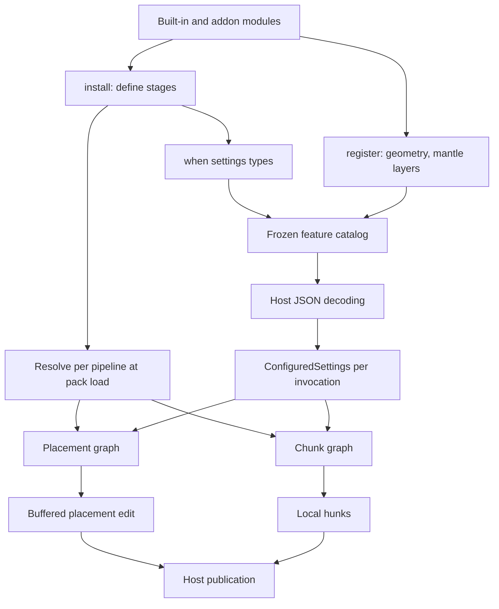

# Iris API design

Status: pack module loading, the stage graph, both pipelines' reference executors, settings
catalog, geometry, resources and typed storage contracts exist and are tested without the Iris
engine. Provider and runtime families at the end are design notes, not Java interfaces.

## Model

An Iris module owns its settings types and the stages that act on them. The host owns resource
loading, platform adapters, scheduling, storage and publication. The core engine is meant to be
a set of ordinary modules (`iris:prepare`, `iris:anchor`, `iris:blocks` and so on). No stage,
phase or hook has special status in the API.

## Module loading

The `IrisModule` implementation is the module's entry point. `info()` returns its id and
version; there is no separate descriptor. A pack keeps its modules in `<pack>/modules/*.jar`,
one module per jar.

A jar names its entry class in `META-INF/services/com.volmit.IrisModule`, the provider format of
`ServiceLoader`. The host reads that file from the jar itself rather than calling
`ServiceLoader`, which would also return providers of parent class loaders and could not say
which jar a broken provider came from. The rejected alternatives:

- A manifest attribute such as `Iris-Module: com.example.MossModule`. It needs the same reading
  code but is not a Java convention, IDEs do not check it, and fat-jar tools tend to rewrite
  manifests.
- A descriptor file with id and version. It duplicates `info()`, so the two can disagree, and
  parsing it needs a format the JDK does not ship.

`PackModules.load(packRoot)`:

1. Lists regular files ending in `.jar` in `<pack>/modules`, sorted by file name. A missing
   directory means no modules.
2. Reads each jar's entry point file. Comments (`#`) and blank lines are ignored; zero or more
   than one class name fails.
3. Creates one `URLClassLoader` for all jars of the pack, parent = the loader of `IrisModule`.
4. Loads each entry class, checks that it implements `IrisModule` and comes from its own jar,
   instantiates it with the public no-argument constructor and calls `info()`.

One loader per pack, not per jar, because `requires(...)` takes another module's stage constant.
A pack jar that requires a stage of another pack jar must see its classes. Packs stay isolated
from each other, and built-in modules visible to the API's loader are visible to every pack. The
cost: two jars of one pack that contain the same class name share the first one in file name
order. The entry-class check catches this for entry classes only.

Closing `PackModules` closes the loader. Classes loaded before that keep working, so the host
must drop `LoadedModules` and everything else built from the pack first.

Each module reaches `LoadedModules.load` as a `DiscoveredModule`: the module and its origin, the
jar path relative to the pack or "host classpath" for built-ins. Duplicate module ids and foreign
stage namespaces name the origin. Every jar error names the jar.

## Stages

A stage is a constant created by `Stage.placement`, `Stage.placementBlock` or `Stage.chunk`. Its
identity is that object. Another module that wants to depend on it references the owner's
constant, which makes the dependency a compile-time one. A copy with the same id is rejected at
resolve time.

| Stage type | Pipeline | Runs | Context |
| --- | --- | --- | --- |
| `PlacementStage<O>` | PLACEMENT | once per placement attempt | `PlacementStageContext` |
| `BlockStage<O>` | PLACEMENT | once per object block, in a block pass | `BlockStageContext` |
| `ChunkStage<O>` | CHUNK | once per chunk invocation | `ChunkStageContext` |

Rules enforced by `StageGraphBuilder` and the resolver:

1. The stage namespace must equal the defining module's namespace. A second definition of an id
   fails and names both modules. Two modules with the same id fail.
2. `requires(stage...)` adds a REQUIRED edge. If the stage is not installed, loading fails with
   both stage ids, the requiring module and the namespace the missing module should have.
3. `softAfter(ref...)` and `softBefore(ref...)` add SOFT edges only when the referenced id is
   installed. Absent targets are kept for diagnostics. A module cannot force itself before
   another module's stage with a hard edge.
4. A stage with output must be defined with `produce` (or `accumulate` for block stages), and a
   stage without output with `run`. Every defined stage needs exactly one body before its
   module's `install` returns.
5. A stage and everything it references must be in the same pipeline, soft references included.
6. Cycles fail and print the whole cycle: each stage with its module and the kind of each edge.

### Order

Resolution is Kahn's algorithm over the pipeline's stages. Among stages whose predecessors have
all run, the lexically smallest id goes first, with one refinement for fusion:

- while a block pass is open, a ready block stage continues it;
- otherwise a ready invocation stage runs first;
- otherwise a block stage opens a new pass.

The result depends only on ids and edges, never on install order. A tie-break on raw lexical id
alone would interleave unrelated invocation stages into block passes and split them. Note that
no topological order can put every unordered pair in lexical order once edges point against the
alphabet, so "lexical" here always means "lexical among ready stages".

### Block passes

Adjacent block stages in the resolved order form one block pass. The placement runner loops over
the request object's blocks once per pass and runs every active stage of the pass on a block
before moving to the next block. A block stage that requires another block stage runs after it
for the same block. An invocation stage between two block stages splits the pass, even when it
is inactive for a particular invocation. The split is static so that `describe()` matches what
runs.

Each pass starts from the request object's blocks. `replace` and `skip` affect only later stages
of the same pass for the same block. Work that later passes need belongs in an accumulator.

### Outputs

Outputs live in a per-invocation array indexed by resolved position. Stage definitions never hold
them. `ctx.output(stage)` scans the current stage's precomputed list of transitive requirements by
identity, which is a handful of entries, then reads the array. There is no hashing per call.
Reading anything outside that list throws `IllegalStateException` and names the fix. A block
stage's accumulator is created once per placement and becomes readable when its pass ends;
reading it from inside the same pass throws. A null output from a stage that declares one fails
the invocation.

### Activation

The graph is resolved once per pack load. Activation is decided per invocation:

1. The host passes `ConfiguredSettings`, at most one value per settings type, for the placement
   or chunk. Merging dimension, region, biome and placement declarations is host policy.
2. The invocation looks up each distinct `when` type once.
3. One pass in resolved order marks a stage active when its settings are present (or it has no
   condition) and every stage it requires is active.

So an inactive requirement deactivates its dependents. That is not an error. Soft edges never
affect activation. The cost per invocation is two small arrays and one pass over stages and
REQUIRED edges. The settings value is passed to the body as its second argument.

For chunks, activation is per chunk. A stage that varies inside the chunk still reads
`ctx.settings().at(...)` per position.

### Diagnostics

`ResolvedGraph.describe()` lists every stage in order with its kind, block pass, owner module,
`when` feature, required and soft predecessors and absent soft targets. It also lists the fused
block passes and every pair of stages with no path between them in either direction. Those pairs
are ordered only by the tie-break, so they are where two modules can silently conflict.
`stages()`, `blockPasses()` and `unorderedPairs()` expose the same data as values.

## Placement attempts

`PlacementRunner.place(request, edit, inputs, settings)` owns the edit. It runs active stages in
order, stops after the current stage or block once a stage calls `reject(reason)`, commits only
when nothing rejected or threw, and closes the edit in every case. Stages receive a buffered
`PlacementAccess` view of the edit without commit or close, and it expires with the attempt.

All stages of one attempt share the host's `PlacementContext`, including one RNG, consumed in
resolved order. Adding a module therefore changes what later stages draw unless modules derive
their own streams. The example ports use the shared RNG like Iris does today.

## Chunk invocations

`ChunkRunner.generate(inputs, settings)` runs active chunk stages once each in resolved order.
`GenerationContext.hunk(type)` returns the host-owned local volume of that value type, shared by
all stages of the invocation. Hunk coordinates are local; samples and mantle coordinates are
world blocks. The runner does no neighbor scheduling or rollback. A failed invocation must stop
the host from publishing the chunk.

## Settings, geometry and storage

Settings types implement `IrisFeature` and carry `@Feature` (namespaced id, display name, JSON
field, attachment targets). `when(type)` validates the annotation while the module installs.
`LoadedModules.load` catalogs those types with geometry generator settings and rejects duplicate
ids and JSON field collisions per attachment target, including reserved host fields.
`OptionsMetadata` reads field metadata; it does not decode JSON.

`GeneratedObject` is sparse, immutable local geometry with bounds, an anchor, sorted blocks,
optional block entity payloads and markers. `ObjectGenerator` produces it from settings and an
RNG. `ObjectTransformer` is host-owned.

The mantle contracts are unchanged: namespaced typed keys, versioned codecs, generation and
persistent lifetimes, ordered sparse visits and buffered edits. Only owners register a layer.
Unknown persisted layers must be preserved or fail explicitly.

## Not implemented

- Iris host wiring: version gating, JSON decoding and validation, schema generation, resource
  loaders, platform block adapters, storage and codecs.
- Reach. The old per-modifier `writeRadius` and `mantleRadius` are gone with the modifiers. The
  host must prepare the whole area a pipeline may touch. Per-stage reach is an open question.
- Legacy random compatibility. Seed offsets and draw order must be matched by the adapter where
  existing worlds are promised to stay the same.
- Real feature ports. The test examples are simplified slices, not parity ports.

## Feature-family migration map

This is an inventory of where each existing family should land, not a claim that it is ported.

| Existing family | Target |
| --- | --- |
| Surface, ceiling, shore, sea and floating decoration | Chunk stages + palette/support/sampling resources |
| Slab/wall/snow post-processing, foliage cleanup, ore hiding | Chunk stages + block traits and neighbor views |
| Custom block recording and deferred application | Chunk stage + persistent typed layers + host content adapter |
| Ores and deposits | Chunk stages + noise/palette resources + configured settings |
| Object selection, transforms, height and placement modes | Geometry + placement stages per mode module |
| Stilt, erosion, ceiling hang, vacuum, paint, floating | Placement modules with block and invocation stages |
| Slope, support, limits, collision, protection, bore, meld, snow | Placement stages that reject or write |
| Markers, tile data, tree and loot metadata | Object metadata + placement edit + typed storage |
| Procedural trees, crystals, fungi, coral, ruins | Object generators returning sparse geometry |
| Cave profiles, carving, cave fluids and decoration | Chunk stages + typed carve layers |
| Floating islands and child biomes | Terrain/biome sampling + chunk and placement stages |
| Structures, jigsaw pools and foundations | Structure assembly producing placement requests |
| Imported/native structures and ownership | Host native-generation policy adapter |
| Terrain layers, fluids, bedrock, interpolation | Terrain providers + chunk stages |
| Region/biome selection | Biome providers + platform biome writer |
| Image maps, noise expressions, pack injection | Compiled immutable pack resources |
| Spawning, effects, drops, loot, tree growth, commands | Separate runtime family with host actions |
| World lifecycle, pregen, locate, studio tooling | Bridge existing integrations |

## Provider and runtime direction

- Terrain and biome providers should return sampled fields and identities. The host adapts them
  to native chunk and biome formats. They must not own worlds or ticks.
- Structure assembly should consume immutable resources and return placement requests. The host
  owns reach, scheduling and native-generation gates.
- Image maps and expressions should compile into pack resources before a snapshot is published.
- Runtime features need their own family with read-only event inputs and requested actions that
  host adapters perform on the right scheduler. Generation hunks, RNGs and views never leak into
  runtime work.

Exact signatures for these families should follow their first real port.

## Readiness gate

A feature replaces its legacy implementation only when existing pack JSON works, representative
seeds match promised output, negative heights and chunk boundaries pass, concurrent execution is
deterministic, reload caches expire and failures cannot publish partial chunks. Until then the
legacy path stays available.
